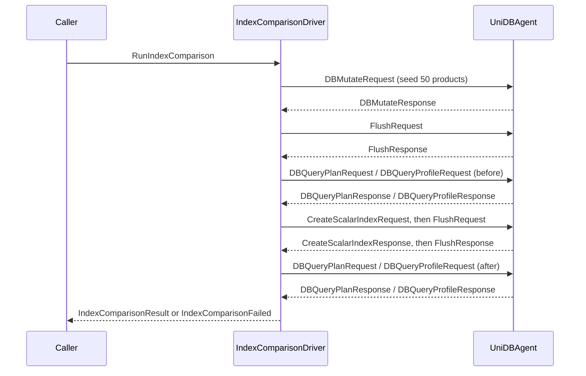

# Uni-DB agent

`rustic_ai.unidb.agent.UniDBAgent` makes Uni-DB a reusable database capability in a Rustic AI guild. Callers send typed messages to query application data, evaluate Locy rules, explain derivations, execute checked mutations, or compare hypothetical changes. The database agent works with deterministic callers and reasoning agents through the same contract.

This guide describes the v1 integration in `rusticai-unidb` 0.0.1, pinned to **Uni-DB 5.2.1 and Python 3.13**. It describes the integration's supported surface, rather than every feature in newer native Uni-DB releases.

## Choose the capability boundary

| Owner | Responsibility |
| --- | --- |
| UniDBAgent | Validate delivered requests, execute bounded database operations, serialize evidence, return correlated results and typed errors |
| Application catalog | Supply schema, queries, Locy programs, mutation statements, assertions, assumptions, and catalog revision |
| Guild | Authenticate callers, enforce permissions and approvals, route requests/results, decide workflow completion, and present results |
| UniDBResolver | Open the configured binding, bootstrap or verify it, cache the agent-scoped runtime, and explicitly close it |

A catalog defines what an instance can execute; it does not authorize a caller. A reasoning agent can invoke selected capabilities through tool adapters. It does not need direct access to native sessions or transactions. Uniko owns cognitive memory behavior and its private store; use UniDBAgent for application-owned graph data and supplied rules.

## Install and configure

In a development checkout of Rustic AI:

```bash
poetry install --with dev
```

For a built distribution, install the `rusticai-unidb` wheel; add its `tools` extra when using the optional LLM bridge. The agent itself has no LLM dependency.

Configure `UniDBAgentConfig` through agent properties and an agent-scoped dependency named `unidb`. Here is a complete AgentSpec for a disposable constant-query service:

```python
from rustic_ai.core.guild.builders import AgentBuilder
from rustic_ai.core.guild.dsl import DependencySpec
from rustic_ai.unidb.agent import UniDBAgent

agent_spec = (
    AgentBuilder(UniDBAgent)
    .set_id("database")
    .set_name("Database")
    .set_description("Application query capability")
    .listen_to_default_topic(False)
    .add_additional_topic("db.requests")
    .set_properties({
        "binding_id": "demo-db",
        "raw_operations_enabled": False,
        "operation_catalog": {
            "revision": "demo-v1",
            "operations": [{
                "name": "echo_value",
                "kind": "query",
                "parameters_schema": {
                    "type": "object",
                    "properties": {"value": {"type": "integer"}},
                    "required": ["value"],
                    "additionalProperties": False,
                },
                "query": "RETURN $value AS value",
                "columns": ["value"],
            }],
        },
    })
    .set_dependency_map({
        "unidb": DependencySpec(
            class_name="rustic_ai.unidb.resolver.UniDBResolver",
            properties={
                "binding_id": "demo-db",
                "open_mode": "temporary",
                "native_config": {"wal_enabled": True, "strict_schema": True},
                "bootstrap": {"policy": "apply_to_new", "revision": "demo-v1"},
            },
        ),
    })
    .build_spec()
)
```

For persistent storage, use the [resolver guide](../../dependencies/unidb/index.md). Startup opens the selected database and applies/verifies the supplied bootstrap before request admission. Opening failures never substitute an empty database.

## Send and observe messages

Within an existing caller processor:

```python
from rustic_ai.unidb.models import DBQueryRequest

request = DBQueryRequest(
    request_id="query:1",
    correlation_id="workflow:1",
    operation="echo_value",
    params={"value": 7},
)
# ctx.send(request) using the real caller's ProcessContext.
```

The producer needs a recurring route for `DBQueryRequest` to `db.requests`. Add the following route to the GuildBuilder before launch, using the actual caller's ID/name:

```python
from rustic_ai.core.guild.builders import RouteBuilder
from rustic_ai.core.messaging import AgentTag

request_route = (
    RouteBuilder(AgentTag(id="caller", name="Caller"))
    .on_message_format(DBQueryRequest)
    .set_destination_topics("db.requests")
    .set_route_times(-1)
    .build()
)
```

Route each success family from the database to a result topic subscribed by its intended consumer. Configure error handling for `DBFailure` on `GuildTopics.ERROR_TOPIC`. The database response preserves `request_id`, `correlation_id`, and `binding_id`; the query result contains columns, rows, row count, and truncation information. A successful database call can be an intermediate step in a larger workflow.

The [protocol reference](protocol.md) lists all request families, limits, error effects, receipt behavior, and tool integration.

## Run complete examples

The following commands run from the Rustic AI repository root after installing development dependencies:

```bash
# Three native application cases with captured typed payloads.
PYTHONPATH=unidb/src python unidb/examples/run_examples.py

# Full message-driven guild; no LLM or provider API key required.
PYTHONPATH=unidb/src:showcase/src python unidb/examples/run_query_diagnostics.py
```

| Example | Initialization and message I/O | What it demonstrates |
| --- | --- | --- |
| Supply network | [GuildSpec](../../design/uni-db-agent-examples/supply-network-init.json), [exchanges](../../design/uni-db-agent-examples/supply-network-messages.json) | Checked atomic import, named query, replay, changed-payload refusal |
| Receivables | [GuildSpec](../../design/uni-db-agent-examples/receivables-init.json), [exchanges](../../design/uni-db-agent-examples/receivables-messages.json) | Integer cents, supplied Locy rules, native proof, absent derivation |
| Supplier scenario | [GuildSpec](../../design/uni-db-agent-examples/supplier-scenario-init.json), [exchanges](../../design/uni-db-agent-examples/supplier-scenario-messages.json) | Scratch evaluation, rollback, guild-owned approval before persistent mutation |
| Query diagnostics | [Detailed workflow](../../design/uni-db-agent-design.md#65-query-diagnostics-guild) | Plan/profile before and after a BTREE index, typed terminal outcomes |

The first three runners exercise native execution; their actual guild messaging and error paths are covered separately by integration tests. The diagnostics runner launches the composed guild, starts its deterministic driver, observes its terminal result, and closes the resolver before shutdown.

The diagnostics guild performs:



Each stage runs sequentially after the preceding response. The captured lookup returns the same row and reports a scan reduction from 50 rows to one. Timing and estimated costs are reported as observed; a small data set need not show a latency improvement. The guild supplies terminal completion/error status and user presentation.

## Operational boundaries

Use one authoritative write owner and local native storage for this integration. Dependency caching does not share a native handle across processes or establish coordinated writers. Catalogs and authorized raw callers must preserve connector-owned receipt metadata.

Explicitly call `UniDBResolver.close()` before guild shutdown; the general Rustic resource shutdown hook remains deferred. Scenario applicability checks, message-driven cancellation, pinned/fork reads, remote storage certification, multi-owner coordination, receipt retention, and artifact/stream delivery are outside the advertised v1 contract.

For deeper implementation rationale, see the [design document](../../design/uni-db-agent-design.md).
