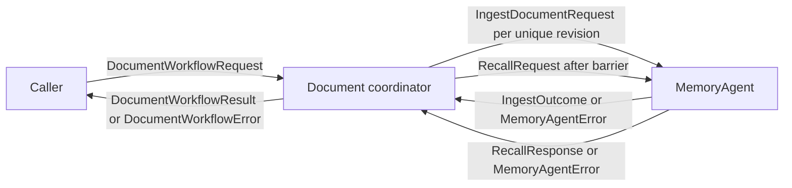

# Document coordinator

`DocumentCoordinatorAgent` provides a reusable document workflow over the existing Uniko MemoryAgent protocols. It snapshots sources, waits for their ingestion outcomes, optionally recalls bounded evidence, and emits one terminal result or typed error. A guild supplies the corpus, routes, filesystem and native memory dependency; synthesis and access policy remain in the guild.

This is the shared foundation for the KnowledgeAgent migration. [PaperBanana v2](../../showcase/paper_banana.md) uses this foundation for uploaded references. The Semantic Memory Assistant migration remains a later phase.

## Initialization and routing

Configure one coordinator for each corpus boundary:

```python
from rustic_ai.uniko_agent import DocumentCoordinatorConfig, MemoryAgentConfig

coordinator_properties = DocumentCoordinatorConfig(
    corpus_session_id="corpus:references",
    memory_agent_id="memory",
    deadline_seconds=120,
)
memory_properties = MemoryAgentConfig(
    allowed_record_producers={"external_evidence": ["documents"]},
    scope_producers=["documents"],
)
```

Use the stable coordinator ID `documents` and MemoryAgent ID `memory` for this configuration. Both agents set `listen_to_default_topic=false`. The coordinator subscribes to request and memory-result topics; MemoryAgent subscribes to its command topic. Routes recur with `route_times=-1`:

| Producer | Message | Destination | Process status |
|---|---|---|---|
| Caller | `DocumentWorkflowRequest` | `documents.requests` | running |
| Coordinator | `IngestDocumentRequest`, `RecallRequest` | `memory.commands` | running |
| MemoryAgent | `IngestOutcome`, `RecallResponse`, `MemoryAgentError` | `memory.results` | running |
| Coordinator | `DocumentWorkflowResult` | `documents.results` | completed |
| Coordinator | `DocumentWorkflowError` | `documents.results` | error |

Typed errors use `ctx.send_error`, which also publishes to the framework error topic. A caller subscribed to both destinations must deduplicate transport copies. Internal memory failures belong to the coordinator's barrier; presentation consumes the coordinator's terminal outcome.



The coordinator uses only the guild filesystem dependency for source access. MemoryAgent resolves its own private native store through `UnikoResolver`. Configure a local filesystem and a persistent `storage_path`, stable organization/guild/agent identities, and one process owner for the store. Remote acquisition must stage sources into the guild filesystem first.

The complete executable guild is [document_guild.py](https://github.com/milliondreams/rustic-ai/blob/main/uniko-agent/examples/document_guild.py):

```bash
poetry run python uniko-agent/examples/document_guild.py --storage /tmp/rustic-documents
```

It ingests a Harbor project document and recalls its budget and coordinator using local native models. Cache the model assets before running in an offline environment. `guild.shutdown()` stops coordinator timers and drains owned native resources. When called synchronously from a running event loop, resource draining continues on a separate thread so accepted work can finish on that loop.

Runtime wrappers invoke the synchronous `Agent.on_shutdown()` hook once, then close resolver instances they constructed for that agent and their owned nested resolvers. `await wrapper.shutdown_async()` waits for resource draining and uses resolver `shutdown_async()` when available. The base hooks are no-ops. Custom resolvers close only their own resources; the runtime does not guess ownership by calling shutdown methods on cached dependency values. Cleanup continues when a hook or unsubscribe fails. A failed resolver remains available for another shutdown attempt, without repeating successful cleanup or the agent hook. Sync and threaded engines retain stopped wrappers with unfinished cleanup and retry them on subsequent shutdown. In-memory message history remains available while another backend owns that namespace; writes, snapshots and namespace cleanup share a lock, and subscriber callbacks run outside it.

## Typed initialization and usage

The request has a caller-supplied ID unique within the coordinator, optional sources and an optional query. Supply at least one source or a nonblank query. A source uses the existing `MemorySource` contract: inline text, base64 bytes or a filesystem `MediaLink`.

```python
from rustic_ai.uniko_agent import DocumentWorkflowRequest, MemorySource

request = DocumentWorkflowRequest(
    request_id="harbor-reference-1",
    sources=[MemorySource(
        source_id="harbor-plan",
        path_hint="harbor.md",
        mime_type="text/markdown",
        text="Harbor pilot budget is CAD 42000. Mina Patel coordinates it.",
    )],
    query="What is the Harbor pilot budget and who coordinates it?",
)
caller.publish_with_guild_route("documents.requests", request)
```

For archival ingestion, omit `query`. For recall from the configured corpus, omit `sources`. For a query that may legitimately return no evidence, set `require_evidence=false`; this returns an empty `RecallResponse` instead of an evidence-unavailable error.

Default `allow_partial=false` makes any failed source ingestion a terminal error after the barrier settles. With `allow_partial=true`, successful sources can proceed to recall while failed-source diagnostics remain visible. An ingestion-only request in which every source failed still returns an error. With `require_evidence=true`, recall must return at least one retained evidence item.

Call `normalize_document_attachment(raw_part)` before parsing chat file parts that discard filename/MIME fields. It accepts `MediaLink` dictionaries, UI `mediaLink` wrappers, current chat `file_url` parts, and base64 data-URI `file` parts. Preserve their original name, MIME and source URI during acquisition. Bare remote URLs are rejected.

## Message outputs and identity

`DocumentWorkflowResult` contains `request_id`, the original query, ordered `sources`, optional `recall`, and `partial`. Each source includes its input index, stable source/revision/record IDs, name/MIME/source URI/encoding when supplied, status, native `IngestOutcome`, and an error code when relevant. The coordinator snapshots effective context after incoming fixtures run, preserving small caller identity and correlation metadata. It omits attachment and conversation-history fields and any whole field exceeding its context bounds: 16 KiB total, 4,096 characters per string, 32 entries per nested collection and four nesting levels. It omits fields rather than truncating identity values. Document bodies travel only in ingestion payloads; keep larger caller state outside the coordinator context. Outgoing send, error and message-modifier fixtures still run on every branch.

```json
{
  "request_id": "harbor-reference-1",
  "query": "What is the Harbor pilot budget and who coordinates it?",
  "sources": [{
    "index": 0,
    "source_id": "document:<logical-source-digest>",
    "revision_id": "<revision-digest>",
    "record_id": "document:<revision-digest>",
    "name": "harbor.md",
    "mime_type": "text/markdown",
    "status": "ingested",
    "outcome": {"stored": true, "searchable": true, "was_deduplicated": false}
  }],
  "recall": {"items": ["<typed RecallItem objects>"], "truncated": false},
  "partial": false
}
```

This abbreviated output illustrates the fields; actual messages contain the complete native outcome and recall models. Pass retained evidence and its provenance to a separate synthesis stage. Keep coverage and truncation diagnostics available instead of reconstructing legacy KB response envelopes.

Logical identity is namespaced by corpus and derived from explicit `source_id`/`id`, source URI/path, or content when no locator exists. Revision identity includes logical identity, content digest and effective MIME. Different bytes at the same logical source create a different immutable revision. Request identity is independent of document identity. Identical inputs within a request share one ingestion operation and retain one ordered outcome per input.

A stored artifact can be unsearchable. Inspect `stored`, `searchable`, `extraction_failed`, and `was_deduplicated` independently. Archival success does not establish retrieval evidence.

## Limits, failures and restart behavior

Defaults are 32 sources, 16 MiB per source, 32 MiB total source bytes, 32 active workflows, a 120-second deadline, and 1,024 completed-request tombstones. Recall is bounded to 10 items, 6,000 characters and 2,000 tokens. Configuration can lower or raise limits within the published schema bounds. Capacity and cheap inline-length guards run before incremental request hashing; source decoding and filesystem reads obey the remaining source/workflow byte budget.

`DocumentWorkflowError` contains `request_id`, `error`, a concise `message`, and available source outcomes. Terminal error codes include invalid request, capacity exceeded, request-ID conflict, failed ingestion, failed recall, unavailable evidence, and workflow timeout. Source normalization failures are recorded as `document_source_rejected` without exposing filesystem exception details.

The absolute monotonic deadline includes source preparation. Expiration runs independently of the serialized inbox, so a slow or blocked filesystem read cannot withhold the terminal timeout. Cooperative reads are bounded by the remaining deadline, and the coordinator checks expiration before native dispatch and terminal completion. A timed-out read never causes a later ingestion dispatch. A deadline marks unresolved sources `unknown`: already accepted native writes might finish despite a lost outcome. The coordinator suppresses duplicate and late replies, checks the expected MemoryAgent sender, and rejects replies carrying an older attempt identifier. Identical raw attachment retries remain identical when the transport omits a generated `MediaLink.id`; source identity fields still participate in the fingerprint. A conflicting reuse of an active request ID, including malformed input reusing that ID, terminates that workflow once. Invalid requests with a usable ID are also tombstoned. Completed duplicates, including malformed reuse, produce no additional outcome while their tombstone remains retained.

Workflow state is bounded and transient. Native documents persist, but unfinished workflows do not resume automatically. After restart, resubmit the unfinished request; within the same running coordinator, use a new request ID to retry a terminal failure. Preserve source identity and bytes so native ingestion can deduplicate or reconcile the retry. Tombstones are bounded, so they do not provide indefinite deduplication or exactly-once writes.

OCR, automatic workflow recovery, legacy data import, and per-document ACL parity are outside this foundation. Guild composition and private stores supply the supported access boundaries.
