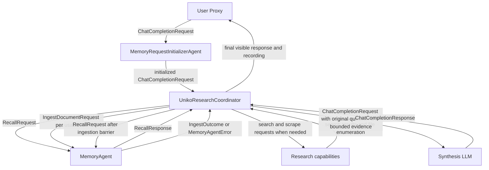

# Uniko memory agent

`rustic_ai.uniko_agent.agent.MemoryAgent` exposes cognitive memory through typed messages. Uniko retains messages, source artifacts, actions, and episodes, then derives observations, bitemporal facts, and reusable procedures with provenance. Recall combines compact facts/procedures, episodic expansion, and chunk search. A reasoning agent and a deterministic workflow can use the same memory capability.

This guide describes `rusticai-uniko-agent` **0.0.6**, with **Uniko >=0.6.0,<0.7.0** and **Python 3.13**. The refreshed integration is tested with Uniko 0.6.0; the completion plan preserves earlier 0.5.1 evidence on macOS ARM64 with the CPU wheel. Model configuration alone does not establish that an extraction or retrieval stage ran.

## Choose the right integration

| Component | Responsibility |
| --- | --- |
| MemoryAgent | Typed memory operations, provenance classification, authorized scope, bounds, outcomes |
| Uniko | Native graph, sources, extraction, consolidation, memory semantics, recall |
| uni-xervo | Model task aliases, provider selection, loading, inference |
| UnikoResolver | Private store per organization/guild/agent, model configuration, lifecycle ownership |
| MemoryRequestInitializerAgent | Authenticated User Proxy identity, exact request correlation, request-specific session |
| UnikoMemoriesStore | Bounded conversational recall and atomic user/assistant recording around an LLM call |
| Guild | Trusted producers, routing, research barriers, synthesis, completion, presentation |

Use **MemoryAgent** when several capabilities collaborate through observable memory messages. Use **UnikoMemoriesStore** when one LLM agent owns a conversational loop and needs memory around its calls. Neither implies a shared database between agent processes.

Use [UniDBAgent](../unidb/index.md) for application-owned graphs, supplied rules, checked business transactions, and scratch scenarios. Uniko owns cognitive memory semantics and its private store; do not expose that store as a generic graph mutation surface.

## Install and configure

In a Rustic AI development checkout:

```bash
cd uniko-agent
poetry install --with dev
```

The first native operation can take longer while models initialize; the local example allows two minutes for its response. Pre-cache model assets for repeatable startup.

The published dependency profile selects the CPU `uniko` distribution. Upstream Metal/CUDA wheels are mutually exclusive with that distribution and are not validated Rustic deployment profiles. Local embedding/NLP models need their model assets cached or downloaded; no hosted generation API is required for memory ingestion, structured experience, consolidation, or recall.

Here is a complete local guild example that creates a goal through the real message bus. It uses disposable native storage and releases owned resources through guild shutdown:

```python
import time

from rustic_ai.core.agents.testutils import ProbeAgent
from rustic_ai.core.guild.builders import AgentBuilder, GuildBuilder, RouteBuilder
from rustic_ai.core.guild.dsl import DependencySpec, GuildTopics
from rustic_ai.core.utils.basic_class_utils import get_qualified_class_name
from rustic_ai.uniko_agent import CreateGoalRequest, GoalView, MemoryAgent, MemoryAgentConfig

filesystem = DependencySpec(
    class_name="rustic_ai.core.guild.agent_ext.depends.filesystem.filesystem.FileSystemResolver",
    properties={"protocol": "memory", "path_base": "/uniko-docs", "storage_options": {}},
)
memory_spec = (
    AgentBuilder(MemoryAgent)
    .set_id("memory")
    .set_name("Memory")
    .set_description("Private cognitive memory")
    .listen_to_default_topic(False)
    .add_additional_topic("memory.commands")
    .set_properties(MemoryAgentConfig(scope_producers=["caller"]))
    .set_dependency_map({
        "uniko": DependencySpec(
            class_name="rustic_ai.uniko_agent.UnikoResolver",
            properties={"storage_path": None, "streaming": False, "llm_spec": None},
        ),
        "filesystem": filesystem,
    })
    .build_spec()
)
response_route = (
    RouteBuilder(memory_spec)
    .on_message_format(GoalView)
    .set_destination_topics("memory.results")
    .set_route_times(-1)
    .build()
)
guild = (
    GuildBuilder(guild_id="uniko-docs", guild_name="Uniko docs", guild_description="Typed memory demo")
    .set_dependency_map({"filesystem": filesystem})
    .add_route(response_route)
    .launch("docs-org")
)
try:
    memory = guild._add_local_agent(memory_spec)
    caller = guild._add_local_agent(
        AgentBuilder(ProbeAgent)
        .set_id("caller")
        .set_name("Caller")
        .set_description("Send and observe typed commands")
        .listen_to_default_topic(False)
        .add_additional_topic("memory.results")
        .add_additional_topic(GuildTopics.ERROR_TOPIC)
        .build_spec()
    )
    command = CreateGoalRequest(
        title="Research battery recycling", goal_id="goal:recycling", operation_id="create:recycling:1"
    )
    caller.publish_with_guild_route("memory.commands", command)
    deadline = time.monotonic() + 120
    while time.monotonic() < deadline:
        messages = caller.get_messages()
        if messages:
            message = messages[0]
            if message.format != get_qualified_class_name(GoalView):
                raise RuntimeError(f"Memory operation failed: {message.payload}")
            print(GoalView.model_validate(message.payload).model_dump(mode="json"))
            break
        time.sleep(0.01)
    else:
        raise TimeoutError("No memory outcome received")
finally:
    guild.shutdown()
```

`GoalView` returns the native goal ID, status, ownership, and operation metadata. Errors arrive as `MemoryAgentError` through `ctx.send_error`. The example uses the probe's publication with the guild routing slip attached; a production caller sending with `ctx.send` needs an output route for each request format. `_add_local_agent` is a local harness API. Runtime wrappers release the native resolver they constructed during guild shutdown. Production deployment uses its managed agent launch path.

For persistent storage and models, see [UnikoResolver](../../dependencies/uniko/index.md). For all message families, see the [protocol reference](protocol.md).

## Conversation memory and identity

Route incoming `ChatCompletionRequest` from an authenticated `upa-…` User Proxy through `MemoryRequestInitializerAgent` before expression-based routing. It preserves the original transport payload and existing context, including attachments, and adds:

- `request_id`: decimal string of the exact transport message ID.
- `request_user`: the User Proxy sender ID.
- `memory_session_id`: `analysis-` plus a SHA-256 digest of guild, sender, and request ID.

This avoids representing 64-bit message IDs through a lossy expression-language number. The initializer rejects missing/untrusted identity through `ctx.send_error(ErrorMessage)`. It is an identity initializer, not a replacement for transport authentication.

MemoryAgent's conversation processors accept configured request/response producers. These two processors have no success acknowledgement; use explicit record/observe protocols when a workflow needs an outcome barrier. Explicit `RecordMemoryRequest` preserves producer-assigned kinds: user assertion, external evidence, deterministic observation, model interpretation, executed result, assistant response, or conversation turn. Recalled claims remain attributed evidence; model interpretation is not promoted to fact merely because it was stored.

## Three useful workflows

### Record and recall research evidence

```python
from rustic_ai.uniko_agent import (
    IngestDocumentRequest, MemoryRecordKind, MemoryScope, MemorySource, RecallRequest,
)

ingest = IngestDocumentRequest(
    record_id="source:recycling-report", session_id="research:recycling",
    source=MemorySource(text="A pilot recovered 90% of its lithium.", mime_type="text/plain"),
)
recall = RecallRequest(
    query="Lithium recovery rate", scope=MemoryScope(sessions=["research:recycling"]),
    allowed_record_kinds=[MemoryRecordKind.EXTERNAL_EVIDENCE],
    item_limit=5, max_characters=3000, token_budget=1000,
)
```

Send ingestion first and wait for `IngestOutcome`. Its `stored` and `searchable` fields distinguish retained bytes from usable extracted evidence. Then send recall; `RecallResponse` returns bounded items with record kind, native provenance, source/revision IDs, and source navigation where available. Empty results are valid. Legacy metadata is not reconstructed on read.

Document sources are inline text, base64 bytes, or a guild-filesystem `MediaLink`. Remote URLs must be fetched by another guild capability before ingestion. The private storage filesystem and the shared document filesystem have different ownership.

### Commit a turn and its tool result atomically

```python
from rustic_ai.uniko_agent import CommitMemoryUnitRequest, ObserveTurnRequest, ToolCallSpec

unit = CommitMemoryUnitRequest(
    operation_id="unit:search:1", unit_id="unit:search", session_id="research:recycling",
    turns=[ObserveTurnRequest(
        sender_id="researcher", message_id="message:search:1", content="Fetched the recycling report.",
        tool_calls=[ToolCallSpec(
            tool_name="fetch_report", call_id="call:report:1",
            json_output={"recovery_percent": 90}, status="succeeded",
        )],
    )],
)
```

`MemoryUnitResponse` contains the committed unit, per-turn identities, and native tool outcomes. Tool output preserves one text/JSON/bytes representation; explicit JSON null is supported. This atomic native unit differs from streaming `BatchSubmitRequest`, whose earlier successful items survive a later failure.

### Track goals, tasks, and experience

Create a goal, use its returned `goal_id` in `CreateTaskRequest`, and update it through explicit task transitions. Record action/episode outcomes with `RecordActionRequest` and `RecordEpisodeRequest`. Add scoped observations and assert facts only with authorized supporting identities. `GoalContextRequest` returns tasks, sessions, recent messages, facts, and entities; its `episodes_available: false` explicitly discloses the 0.6.0 context limitation.

Use `MatchProceduresRequest` for learned procedures and `RecordProcedureUseRequest` for feedback. Store-wide consolidation, fact invalidation, and procedure feedback require an explicitly allowed `control_producers` sender; the default list is empty.

## Conversational LLM wrapper

Configure `rustic_ai.uniko_agent.UnikoMemoriesStore` in an LLM agent's `llm_request_wrappers` with an agent-scoped `uniko` dependency. It derives a user-isolated session from User Proxy identity, recalls bounded context, and labels earlier memories as untrusted factual context. Successful user/assistant pairs are recorded atomically and finalized. Identity and recording failures remain visible; an arbitrary sender cannot select another user's conversation by supplying a session string.

This wrapper accesses its LLM agent's private store directly through a dependency. It is a different composition from messaging a separate MemoryAgent. Choose the ownership boundary deliberately rather than combining both storage paths accidentally.

## Research guild composition

The checked-in [research guild source](https://github.com/rustic-ai/rustic-ai/blob/969e69e90b8ed59233dd2a89d73d4ebbcbfdb7e9/showcase/apps/uniko_research_guild.json) uses `UnikoResearchCoordinator` to own each request's state:



The coordinator waits for expected enumeration and per-document outcomes, ignores duplicate/late responses, and decides when recall or synthesis can proceed. The current sufficiency heuristic is a recalled score above 0.05, not proof that an answer is correct. Search/scrape/synthesis require their own provider and runtime configuration.

## Supported boundaries

Core memory and structured experience have executable acceptance evidence in the [completion plan](../../design/uniko-agent-completion.md). BGE-M3 dense/sparse/ColBERT certification, scanned-PDF OCR, richer multimodal memory, accelerated deployment profiles, and operational-scale certification remain separate open gates. Default model warmup is best effort; `require_verified` readiness is rejected. Source visibility is supported on turns, while explicit document visibility is unavailable in 0.6.0 and rejected.

Keep the structured operation journal alongside persistent native storage during backup/restore. Shut down the resolver explicitly: `shutdown()` outside active event-loop work or `await shutdown_async()` when draining on an event loop. External raw native handles can prevent clean shutdown and their errors remain visible.

## Document workflow foundation

Use the [Document Coordinator](documents.md) for bounded source normalization, immutable ingestion identities, multi-source barriers, and explicit corpus recall. It collaborates with MemoryAgent through existing typed messages and leaves synthesis and access policy in the guild. Its workflow state is transient; native documents persist and callers retry unfinished work after restart.
