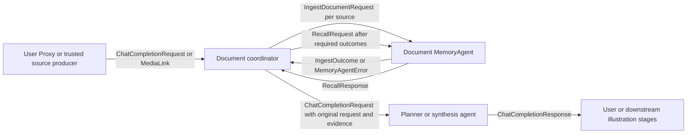

# KnowledgeAgent migration to Uniko

Replace the LanceDB integration, KnowledgeAgent and its knowledge-base implementation with Uniko for document ingestion, evidence retrieval and semantic conversational memory. Migrate the existing consumers directly to Uniko's typed protocols, then remove the retired implementation. Keep generic media, filesystem, embedding and vector-store capabilities that have independent consumers.

This is an implementation plan against repository revision `3c530d5` on 2026-11-25. Phases 1–4 are implemented: the shared foundation, both consumer migrations and legacy retirement. Phase 5 broad repository acceptance and Phase 6 deployment cutover remain pending. Package versions are unchanged; coordinated breaking-release versioning is a separate publication gate. The migration assumes existing deployed content may need preservation until deployment inventory establishes otherwise. Removing code does not authorize deleting stored data.

## Migration decision and scope

The target is one reusable Uniko capability with separately configured instances for meaningful corpus and ownership boundaries. A document `MemoryAgent` retrieves external evidence; a synthesis agent decides how to use it. A conversational `UnikoMemoriesStore` can remain local to an LLM agent. These roles need not share a native database.

Retire the old Knol catalog, table schema, pipeline and backend-selection contracts instead of rebuilding them as a second knowledge stack around Uniko. The two checked-in consumer guilds do not require arbitrary table targets or backend SQL-style filters. External deployments using those public contracts require an explicit migration disposition before upgrading to the release that removes them.

The migration does not require changing the native UniDB repository. UniDB remains the generic application-graph capability. Chroma and the generic VectorAgent remain separate vector-store capabilities. Existing dated dependency and implementation reports remain historical evidence.

## Baseline consumer inventory

| Consumer or surface | Baseline dependency | Required migration |
| --- | --- | --- |
| [PaperBanana](https://github.com/milliondreams/rustic-ai/blob/3c530d596b98217c47dad490f5d8cf24d0a294e3/showcase/apps/paper_banana_guild.json) | KnowledgeAgent through `IndexMediaLinks`, `KBSearchRequest` and result routes | Document ingestion, correlated completion, bounded recall and evidence-to-planner conversion |
| [Semantic Memory Assistant](https://github.com/milliondreams/rustic-ai/blob/3c530d596b98217c47dad490f5d8cf24d0a294e3/showcase/apps/semantic_memory_assistant.json) | `KnowledgeBasedMemoriesStore`, `kb_backend`, filesystem and scraper | Existing Uniko conversational wrapper plus explicit document evidence ingestion/recall |
| [KnowledgeBasedMemoriesStore](https://github.com/milliondreams/rustic-ai/blob/3c530d596b98217c47dad490f5d8cf24d0a294e3/llm-agent/src/rustic_ai/llm_agent/memories/knowledge_memories_store.py) | Constructs KnowledgeBase directly | Retire the implementation and remove its eager package import/export |
| [Iterative Studio](https://github.com/milliondreams/rustic-ai/blob/3c530d596b98217c47dad490f5d8cf24d0a294e3/showcase/apps/iterative_studio/iterative_studio.json) | Unused `kb_backend` resolver | Remove dead configuration and associated documentation/test expectation |
| Saved catalog blueprints and GuildSpecs | Old class names, resolver names and plugin kinds | Inventory and rewrite or reimport specifications before upgrading those guilds to the release that removes the old classes |
| External Python users | Public KnowledgeAgent, KnowledgeBase and Knol APIs | Breaking-release guidance with direct replacement examples |

At the baseline revision, production imports into `core/knowledgebase` originated only from KnowledgeAgent, KnowledgeBasedMemoriesStore and the LanceDB adapter. The directory contained 49 Python files and 5,859 lines. That establishes the repository removal boundary; it does not establish deployed usage.

At the baseline revision, neither consumer had tests selecting its blueprint filename. PaperBanana now has executable acceptance coverage in `showcase/tests/paper_banana`; Semantic Memory Assistant now has executable native-memory, document and browser acceptance coverage.

## Capability mapping

| Existing contract | Target contract | Consequence |
| --- | --- | --- |
| `IndexMediaLinks` document list | One `IngestDocumentRequest` per source, returning `IngestOutcome` | Coordinator owns fan-out, source enumeration and an outcome per item |
| Text/document extraction and embedding | Native Uniko ingestion | Verify actual supported formats and the selected model profile |
| `KBSearchRequest` and `KBSearchResults` | `RecallRequest` and `RecallResponse` | Explicit scope, record kinds and output bounds; original query stays in workflow context |
| Knol/chunk reading | `SourceReadRequest` and `SourceResponse` | Source IDs/addresses change; support read, outline and original content explicitly |
| Source text search | `SourceSearchRequest` | Deterministic source hits and identifiers remain available |
| Reindex and revisions | Stable `source_id`, immutable `revision_id`, default current-only recall | New revisions must not silently blend superseded facts into current answers |
| Delete a document | `ForgetMemoryRecordRequest` with `kind=external_evidence` | Existing artifact path invokes native document deletion |
| Delete a corpus | `DeleteMemorySessionRequest` | Corpus lifecycle is explicit |
| Semantic conversational memory | Existing `UnikoMemoriesStore` | User isolation, bounded recall and user/terminal-assistant recording replace random text-file memory IDs |
| Backend-native answer generation | Optional `AnswerRequest` | Migrated knowledge flows use recall followed by separate synthesis |
| Catalog-only Knol storage | Ordinary source files plus optional Uniko ingestion | Retire the Knol-specific catalog API; storage success and searchability are separate |
| Arbitrary tables, vector columns and custom pipelines | Retired | Do not silently accept old configuration or imitate backend schema machinery |
| Weighted search targets, BoolFilter, hybrid weights, named rerank strategies and backend explain output | Retired controls; use supported Uniko scope/recall options | Preserve required application behavior through explicit source/session/category selection |
| Arbitrary metadata sidecars | Supported provenance fields plus an archival source manifest | Preserve author/tags/date/custom metadata where required; current document ingestion does not carry every old scalar field |

Current native tests cover text, Markdown, HTML, CSV, JSON, code and text-bearing PDFs. Scanned PDF OCR, BGE-M3 hybrid acceptance and richer multimodal processing remain separate completion gates in the [Uniko completion plan](uniko-agent-completion.md). Format acceptance alone must not become a claim that extraction produced searchable evidence.

## Target ownership and message flow

| Component | Responsibility |
| --- | --- |
| Guild and deployment | Corpus access policy, trusted producers, source acquisition, placement, persistent volumes and credentials |
| Narrow document coordinator | Normalize transport inputs, preserve original request, assign source identities, collect outcomes, select explicit scope and build bounded synthesis input |
| Document MemoryAgent | Execute typed ingestion, recall, source-read and deletion operations in its private native store |
| Synthesis or planner agent | Interpret the user's request using attributed evidence |
| UnikoMemoriesStore when selected | Record and recall visible conversation turns around the LLM's calls in the LLM's own private store |
| Native Uniko | Source storage, extraction, indexing, revisions, memory semantics and recall |



Use semantic topics such as `knowledge.ingest`, `knowledge.recall`, `knowledge.results` and `knowledge.errors`, stable agent IDs and explicit subscriptions. Internal agents have `listen_to_default_topic: false`. Reuse the same MemoryAgent class rather than introducing a renamed KnowledgeAgent facade.

A coordinator is justified where lists of sources, asynchronous outcomes and request continuation need an owner. Keep the coordination code narrow. Payload-only conversions remain routing transformations; source identity, barriers and replay-safe terminal state should not become a large opaque expression.

### Correlation and completion

Assign a workflow `request_id` and stable source-item identities before dispatch. Carry only compact correlation, original query and selected corpus in context. Keep source bytes, documents and model reasoning out of shared workflow state.

A barrier tracks the exact enumerated source IDs and one terminal outcome per ID. `stored`, `searchable`, `extraction_failed` and `was_deduplicated` have separate meanings. Neither `success=true` nor the number of replies proves that all references were indexed. An unsearchable but stored source remains an archival source, not usable retrieval evidence.

Define these terminal behaviors:

- Upload only: report stored, searchable and failed source counts accurately.
- Upload plus instruction: after required ingestion outcomes, recall evidence and continue the original instruction.
- Some usable sources: continue with explicitly attributed partial evidence when the workflow permits it.
- No usable source when a reference is required: emit one typed terminal error before synthesis.
- A text-only illustration request without required references: allow explicit no-evidence generation without claiming retrieval succeeded.
- Duplicate, late or out-of-order outcomes: no repeated ingestion accounting, reopened workflow or second terminal output.

Use `ctx.send_error` for typed failures. Progress and per-item diagnostics do not become additional terminal answers. Persist terminal markers and remove only the completed request's transient state when restart continuity is promised. Include timeouts and interrupted-ingestion reconciliation; a lost outcome must not leave a barrier waiting forever.

## Storage, identity and source policy

### Native store ownership

UnikoResolver keys storage and handles by organization, guild and agent. One document MemoryAgent and one LLM using UnikoMemoriesStore therefore resolve different stores. A shared guild ID does not merge their data or locks. Send document evidence explicitly to synthesis; do not make synthesis open another agent's database.

Persistent Uniko storage currently requires a local agent filesystem. Schedule it onto a durable local volume with stable identities, backup policy and one clear process owner. In-memory storage is for disposable tests. Verify close/reopen and actual resolver shutdown before claiming restart persistence.

The standard FileSystemResolver uses one configured protocol for both agent and guild scopes. For deployments currently reading sources from a remote filesystem, preserve acquisition through explicit local staging or a separately supported source/storage dependency binding. A class-name substitution does not automatically preserve remote-source access together with a local native store. If remote-source parity is required, implement and test a narrow binding extension rather than changing the global filesystem resolver's behavior for unrelated agents.

### Corpus and source identity

Use a stable corpus session such as `corpus:paperbanana:references`. `MemoryScope.sessions` accepts at most 32 entries, so do not create an unbounded session-per-document search scheme. Separate private corpora or agent stores when access boundaries differ. `sessions=null` means the whole private store and must not be treated as the current user.

Assign:

- `source_id`: stable logical source identity, based on the known source URI or archival identity.
- `revision_id`: immutable, store-unique source revision, usually including a content digest.
- `record_id`: stable source-plus-revision identity for repeatable ingestion.
- `request_id`: workflow correlation independent of the source revision.

Document recall selects `allowed_record_kinds=[external_evidence]`. Generated plans, model interpretations and assistant replies do not automatically become external evidence. Preserve actual MIME, filename, source URI and available provenance. Never infer author, original bytes, revision chronology or user ownership that the old data did not record.

Current Uniko 0.6.0 rejects document `visibility` fields. The migration must not advertise per-document viewer ACL parity. Guild routing, corpus selection and private stores supply the supported boundaries. Test every intended cross-user or cross-corpus access path.

### Repeat ingestion and uncertainty

Native duplicate ingestion for repeated identities is tested. IngestDocumentRequest has no structured-command `operation_id`, so it does not inherit the structured command receipt contract. A worker crash after storage but before delivery of IngestOutcome can leave an uncertain result.

Retry with the same source/revision/record identities and reconcile stored source presence/outcome. Track ambiguous imports in a resumable migration journal. Do not claim exactly-once effects from broker persistence or reuse the UniDB transaction receipt store for document ingestion.

## PaperBanana migration

At the baseline revision, the blueprint routed file input to indexing and text input to search. It then converts retrieval results into a planner prompt, followed by stylist and visualizer stages. Keep those illustration capabilities and their output contracts.

Repair these boundaries as part of the migration:

1. The upload expression currently hardcodes `application/pdf`, names every file `upload` and sets `on_filesystem=false`. Preserve actual transport metadata and stage uploaded files into the guild filesystem. Uniko rejects an external MediaLink on the document-ingestion path.
2. File-plus-instruction input currently discards the instruction after an indexing acknowledgment. Preserve the original request and implement the explicit upload-plus-instruction continuation described above.
3. The existing default indexing pipeline is text-oriented while the blueprint marks every upload as PDF. Verify real text-bearing PDF extraction and source attribution in the replacement.
4. The indexing response counts every result, including failures, as indexed. Replace it with stored/searchable/failed accounting from per-source outcomes.
5. RecallResponse has no `query_text`. Build the planner input from preserved original query plus bounded `items`, their source IDs and provenance.
6. Keep corpus evidence separate from plans, style instructions and critiques. Empty evidence and missing required references have different outcomes.

Create executable blueprint tests for text-only requests, upload-only requests, upload-plus-instruction, multiple files, partial failure, complete failure, duplicate outcomes, recalled evidence attribution and the request reaching the existing planner/visualizer path. No image-provider calls are required to validate routing; use a deterministic endpoint and a local native document store for the evidence path.

## Semantic Memory Assistant migration

Replace KnowledgeBasedMemoriesStore with `rustic_ai.uniko_agent.memories.UnikoMemoriesStore`, located in the Uniko package. Remove filesystem/KB plugin dependencies that only served the old store. Configure its `uniko` dependency and the private filesystem needed for persistence.

Keep `rusticai-llm-agent` independent of `rusticai-uniko-agent`: Uniko already depends on llm-agent. Adding the new plugin or a hardcoded import into llm-agent would create a cycle. Dynamic plugin configuration can select the existing Uniko wrapper.

Use trusted User Proxy identity or preserved forwarding metadata. The wrapper requires that identity; an internal coordinator's sender tag alone is not sufficient. The original user request and terminal assistant response are the visible turns to remember.

The current scraper-return expression creates a synthetic user prompt with file attachments. Migrate scraped pages as external evidence through the document agent, then return bounded recall evidence to the original conversation. Do not record scraper feedback, correction instructions or synthesized evidence prompts as new user-authored turns.

The conversational wrapper and document agent own separate stores. The synthesis input combines returned document evidence with the wrapper's bounded prior-conversation context. If a future use case requires one message-first memory store, compose explicit record/finalize/recall exchanges; do not silently introduce shared native handles.

Test follow-up recall, distinct users, repeated identical user instructions, failed model calls, scraper partial/complete failure, source attribution, preservation of the original request through internal continuations, exactly one terminal reply and restart behavior. Tool calls must retain valid assistant/tool pairing in the live conversation; retrieved memories are evidence rather than orphaned historical tool messages.

## Current protocol examples

These examples use current Uniko message/configuration models. IDs are illustrative. The document coordinator and PaperBanana guild are implemented; the Semantic Memory Assistant v2 is also implemented.

Document ingestion on `knowledge.ingest`:

```json
{
  "record_id": "ref:harbor:r1",
  "session_id": "corpus:paperbanana:references",
  "source_id": "reference:harbor",
  "revision_id": "reference:harbor:r1",
  "media_link": {
    "url": "file:///uploads/harbor.md",
    "name": "harbor.md",
    "mimetype": "text/markdown",
    "encoding": "utf-8",
    "on_filesystem": true
  }
}
```

Consume IngestOutcome's `record_id`, `stored`, `searchable`, `extraction_failed`, `was_deduplicated`, `artifact_id` and chunk identifiers. A response is one source outcome, not completion of an entire input list.

Bounded evidence recall on `knowledge.recall`:

```json
{
  "query": "Find the Harbor architecture and data flow",
  "scope": {"sessions": ["corpus:paperbanana:references"]},
  "allowed_record_kinds": ["external_evidence"],
  "item_limit": 3,
  "max_characters": 6000,
  "token_budget": 2000
}
```

The coordinator consumes RecallResponse `items` and builds the planner request using the original query and each retained item's content/source identifiers. Keep its `truncated`, coverage and token-count facts available for diagnostics rather than fabricating an old KBSearchResults envelope.

Relevant MemoryAgent properties:

```json
{
  "allowed_record_producers": {"external_evidence": ["document_coordinator"]},
  "scope_producers": ["document_coordinator"]
}
```

Relevant dependency selections:

```yaml
filesystem:
  class_name: rustic_ai.core.guild.agent_ext.depends.filesystem.filesystem.FileSystemResolver
  properties:
    path_base: /var/lib/rustic
    protocol: file
    storage_options:
      auto_mkdir: true
    asynchronous: false
uniko:
  class_name: rustic_ai.uniko_agent.UnikoResolver
  properties:
    storage_path: uniko
    streaming: false
    llm_spec: null
```

These are dependency-map entries, not a complete deployment specification. Native models must be selected and cached for the intended deployment. Scope follows processor declarations and resolver calls; do not add an unsupported `scope` property to DependencySpec.

## Existing data and saved specification migration

Treat configuration migration and content migration as separate operations. Inventory deployed guilds, saved catalog blueprints, externally constructed specs and corpus locations before destructive cutover. If no deployed data exists, the offline import work can be skipped after that fact is established.

### Export before retiring the old runtime

The old Knol layout is `library/<knol-id>/content`, `.knol` and `.meta`, with additional derived chunks and backend-specific vectors. Conversation memories use `guild/memories/<random-id>.txt` and adjacent metadata sidecars.

Export content and metadata using the old release before upgrading an existing deployment to a release that removes its APIs. Produce a manifest with old identities, source path/URI, available MIME, content digest, provenance, destination corpus, logical source/revision/record IDs and per-item status. Keep archival metadata that has no direct Uniko field. Prefer original bytes when available; explicitly label normalized or derived content if originals cannot be recovered.

Rebuild indexes through Uniko ingestion. Do not transplant LanceDB vectors, dimensions, Knol chunk IDs or native database IDs. Search parity is evaluated by useful facts and attributed sources, not identical rankings or scores.

Legacy conversation sidecars contain roles and timestamps but lack reliable user/session ownership. Import them only with an explicit destination identity mapping. Ambiguous records remain preserved in the export, pending assignment; they must not be promoted into a shared corpus or attributed to an invented user.

### Reimport and verify

Use an offline importer consuming the export manifest and content files without importing the deleted KB runtime. Stable identities and a journal make imports resumable. Reconcile duplicate/uncertain outcomes rather than relying on in-memory progress.

Verify source hashes/counts, stored versus searchable outcomes, provenance, reference queries, current-only revision behavior, source reads, delete behavior and close/reopen. Source-read scope for a stored source with no chunks needs an explicit test: current session-only fallback differs from more restrictive filters.

Retain the original export/store until verification and the deployment cutover are complete. Keep old-release configuration and content backups usable for rollback. Drain active old guilds before installing a release that removes their classes. Rewrite saved class names, resolver names, plugin kinds and routes directly; do not add a permanent legacy protocol adapter to the new runtime.

## Removal and retention boundaries

| File group | Action and sequencing |
| --- | --- |
| `lancedb/` | Remove package, manifest, lock, exports, README and three backend test modules after consumer/data preparation |
| `core/src/rustic_ai/core/agents/indexing/knowledge_agent.py` | Remove old class and its message models after PaperBanana migrates |
| `core/src/rustic_ai/core/knowledgebase/` | Remove all 49 files after the remaining Python consumers disappear |
| `core/src/rustic_ai/core/guild/agent_ext/depends/knowledgebase/` | Remove stale resolver facade; it currently refers to a missing backend_resolver module |
| `llm-agent/.../memories/knowledge_memories_store.py` and its import/export | Remove together before deleting core KB modules; eager imports can otherwise break unrelated LLMAgent loading |
| `core/tests/knowledgebase/`, KnowledgeAgent tests and LanceDB tests | Retire after replacement outcome tests exist |
| Mixed resolver/memory tests | Remove only old KB cases/fixtures; preserve other memory, filesystem, KV and code contracts |
| `core/agents/indexing/__init__.py` | Keep other indexing exports and agents; remove only references actually belonging to KnowledgeAgent |
| Chroma, VectorAgent, generic VectorStore/Embeddings, media and filesystem | Retain independent capabilities and tests |
| JSONPath and PyArrow dependencies | Retain independent uses in JSON utilities and pandas analysis |
| Old KB-specific third-party dependencies | Remove only after a whole-repository import/manifest check proves they are unused |

Removing LanceDB does not remove all Arrow or machine-learning packages: other modules still use them. Determine actual dependency/install reduction from regenerated locks and a clean installation.

## Implementation sequence

Phases 1–5 implement and verify the repository migration using the existing local environment. They can proceed while deployed-data inventory is unresolved. Phase 6 owns the deployment cutover; it requires the actual data, saved specifications and target environment. Removing the old implementation from the repository does not upgrade deployed guilds or remove their stores.

| Phase | Deliverable | Depends on | Exit checks |
| --- | --- | --- | --- |
| 0 Investigation | Consumer/dependency inventory, capability mapping, removal boundary and this plan | Complete | Current Uniko native baseline: 24 tests passed; protocol examples validate |
| 1 Shared migration foundation | Narrow document coordinator, source normalization, stable identities, ingestion barrier, bounded evidence conversion and migration-relevant lifecycle fixes | Phase 0 | Native ingest/recall, stored versus searchable outcomes, duplicate/late/time-out handling, terminal errors and shutdown/reopen pass through the real message bus |
| 2 PaperBanana migration | Replace KnowledgeAgent routes with Uniko ingestion/recall and preserve the existing illustration stages | Phase 1 | Text-only, upload-only, upload-plus-instruction, multiple sources, partial/total failure and evidence reaching the planner all pass |
| 3 Semantic Memory Assistant migration | Select existing UnikoMemoriesStore, migrate scraper evidence/continuations, retire the old memory plugin and its eager export, remove Iterative Studio's unused KB dependency | Phase 1 | User isolation, follow-up memory, original request identity, valid tool history, internal-prompt exclusion and one terminal reply pass; ordinary LLMAgent imports remain valid |
| 4 Legacy retirement | Remove LanceDB, KnowledgeAgent, KB internals and exclusive tests; update package registration, affected locks, current guides and migration/release notes | Phases 2 and 3 | No live imports/configuration references remain; independent vector/media/embedding capabilities remain intact; removed editable packages do not mask dependency errors |
| 5 Repository acceptance | Verify clean installed wheels, packaged migrated guilds, native persistence and broad monorepo regressions | Phase 4 | All remaining package builds/lock checks, relevant tests, types/lint and strict documentation pass; source-read/revisions/deletion/reopen and both complete guild flows pass |
| 6 Deployment and existing-data cutover | Export/reimport any old corpora, migrate saved specs, verify the target deployment, drain old guilds and switch to the declared breaking release | Phase 5 and deployment inventory | Source hashes/counts, searchable outcomes, ownership, resumability, cold/warm native recall and rollback are verified before upgrading; skip data import only when no old data exists |

Phases 2 and 3 can run independently after the shared foundation is stable. Phase 4 starts only after both consumer migrations pass. Each implementation phase ends with its focused tests and a concrete diff; acceptance in phase 5 broadens verification rather than postponing correctness checks until cleanup is finished.

### Phase 1 foundation boundary

Reuse existing Uniko request/result models. Add only the deterministic coordination needed by the two consumers: source enumeration, immutable per-source identity, compact correlation, outcome accounting, bounded recall and terminal cleanup. Preserve original transport metadata before typed file parsing drops presentation fields. Select a stable corpus session and private local native storage for the local baseline.

Address lifecycle, request-normalization or late-outcome defects only where the selected migration path relies on them. The broader code-review backlog remains separate. Native AnswerRequest, generic readiness APIs, OCR and arbitrary schema/filter compatibility are not prerequisites for the explicit recall-plus-synthesis path.

### Phase 1 implemented foundation

The Uniko package now provides `DocumentCoordinatorAgent`, typed workflow contracts and schemas, a raw-attachment normalization helper, and an executable local persistent guild. See the [document coordinator guide](../agents/uniko/documents.md) for initialization and message I/O. Core wrappers expose an owned-resource shutdown path; sync/threaded shutdown preserves other guilds and their in-memory message history, and multiprocess shutdown preserves unrelated children. The Phase 1 review fixes add independent monotonic deadlines during source preparation, stable raw-request retry fingerprints, terminal guards for invalid ID reuse, bounded effective context after fixtures, incremental input hashing, synchronized shared-store mutation and retryable native cleanup from active event loops.

Workflow coordination is transient. Documents and their immutable source/revision identities persist; callers resubmit unfinished workflows after restart. There is no automatic workflow continuation or durable terminal journal in this phase. Within a running coordinator, retry a terminal failure with a new request ID while preserving the source identities and bytes. Bounded tombstones suppress completed duplicates only while retained.

PaperBanana migrated in Phase 2 and Semantic Memory Assistant in Phase 3. Phase 4 removes KnowledgeAgent, LanceDB and their dedicated knowledge-base internals and tests.

### Phase 2 implemented PaperBanana

The v2 blueprint replaces KnowledgeAgent with the shared document coordinator and MemoryAgent, plus an application coordinator for ingestion, source-scoped recall and bounded illustration refinement. Upload-only requests report native stored/searchable outcomes. Upload-plus-instruction requests require evidence from successful current uploads; text-only requests may proceed explicitly without evidence. Critique uses a validated JSON verdict and at most two refinements. Public typed outcomes and one terminal UI projection cover success and error paths.

The [PaperBanana guide](../showcase/paper_banana.md) documents initialization, HTTP acquisition policy, typed I/O, persistence and limits. Acceptance tests execute the shipped routes with deterministic generation dependencies and real native Uniko text/PDF ingestion, source scoping, reopen and deduplication. Default HTTP origins are empty; deployment configures acquisition permissions and credentials. Active workflows remain transient. Phase 2 review corrections add Studio/file-URI transport resolution, independent staging paths, redirect cookie isolation, deduplicated artifact readiness, early source-timeout continuation, enriched-history exclusion, and coordinator plus guild-entry deadline guards. Regression coverage includes delayed dispatch and repeated upload-plus-instruction after restart.

### Phase 3 implemented Semantic Memory Assistant

The v2 blueprint uses the existing Uniko conversation wrapper in deferred-recording
mode, a typed commit processor on the owning conversational LLM agent, and an
application coordinator for bounded distributed web tool rounds. Shared document
evidence flows through DocumentCoordinator and a separate MemoryAgent. Original
user identity and assistant/tool pairing survive continuations. Only accepted
visible turns are persisted; unconfirmed commits return the answer with a warning.
The retired wrapper and eager export are removed, as is Iterative Studio's unused
KB dependency. See the [assistant guide](../showcase/semantic_memory_assistant.md)
for initialization, protocols, limits and saved-spec migration.

### Phase 4 implemented legacy retirement

KnowledgeAgent, its message models, all core knowledge-base internals, the stale knowledge-base resolver namespace and the LanceDB subproject are removed. Their exclusive tests are retired; mixed resolver tests retain KV, filesystem and code-runner assertions. Independent VectorAgent, Chroma, embeddings, media, filesystem and pandas capabilities remain. The root LanceDB dependency and module registration are removed, and the root lock is refreshed without unrelated version upgrades.

The [retirement notice](../agents/core/knowledge_agent.md) lists removed APIs, direct Uniko replacements, saved-spec migration and native persistence requirements. The old documentation URL remains as a migration entry point. Historical reports and the pre-retirement source snapshot remain available; this cleanup performs no stored-data deletion or export/import.

Package versions and published constraints are unchanged in this phase. A separate release task must choose a coordinated breaking version and update affected package constraints before publication. Focused retirement verification does not complete Phase 5's broad monorepo acceptance or Phase 6's deployed-data cutover.

Focused Phase 4 verification on 2026-11-26: 309 regression tests passed, and all 679 remaining core tests collected. Thirteen fresh package builds excluded retired code; a clean environment containing those non-editable wheels passed 12 copied guild-flow tests plus independent native Chroma upsert/read/search/deletion. The root lock removed five LanceDB-only packages without changing remaining dependency versions. Retirement examples, blueprint class validation, affected lint/types and strict documentation builds passed. Native guild tests require access to their local model cache; no hosted synthesis provider was used.

### Phase 5 local verification boundary

Use real native Uniko stores and the production message/routing paths. Deterministic LLM/planner endpoints verify evidence delivery and continuation without hosted-provider keys; native ingestion/recall must execute rather than be stubbed. Clean wheel installation verifies that the current development environment is not hiding retired dependencies.

Local acceptance establishes the repository behavior. It does not establish the production operating system, scheduling, volume durability, model readiness or saved-data migration. Those claims belong to phase 6.

### Phase 6 required deployment inputs

Identify existing corpus/source locations, saved GuildSpecs/catalog blueprints, and the destination identity map for legacy conversation records. Confirm the operating system, execution engine, local persistent volumes and selected Uniko model profile. Preserve original stores and a resumable export/import journal until cutover checks pass.

If deployment inventory establishes that there are no old corpora or saved configurations, omit export/import and verify a fresh target deployment instead. Production synthesis-provider checks can use the deployment's existing credential configuration when required; phases 1–5 do not require new provider keys.

Publication requires a declared breaking framework release for removed public APIs rather than a patch release under old compatibility promises. Phase 4 deliberately leaves current versions unchanged until that separate release task. Update published dependency constraints across affected packages. Uniko and pandas-analyst currently constrain core/llm-agent below 1.5.0, so version selection and package metadata must be coordinated. Planning this release does not publish packages or create a pull request.

## Packaging and documentation work

Remove `rusticai-lancedb` from root pyproject.toml and `lancedb` from scripts/modules.sh. Build/publish scripts read that list. Refresh root Poetry lock; refresh other Poetry/uv locks when version/dependency changes require it. Showcase already depends on Uniko, so the guild replacements need no new package dependency.

Update the agent inventory, KnowledgeAgent navigation, semantic-memory/plugin guides, migrated showcase READMEs and current Uniko examples. Replace current guidance to removed FQCNs; preserve dated audit reports. No tracked blackbook artifact exists in this checkout, so external documentation updates require identifying its maintained location separately.

Use a clean environment to ensure removed editable packages and old wheel artifacts do not mask imports. Verify metadata and imports from built wheels as well as the source tree. Failure-propagating package checks must prove each remaining package built successfully; the reviewed run_on_each runner currently masks failures.

## Acceptance and evidence

Current migration-fit tests: **24 passed in 82.59 seconds** on Uniko 0.6.0, covering native formats, recall/source/revision/bounds, private filesystem restart/isolation and writer-reader provenance. This is a current capability baseline, not validation of the proposed migrated guilds.

Offline PaperBanana route probes validated text and one/two-file payloads, and demonstrated the failed-index response counting failure as indexed. Example ingestion, recall, deletion, source-read, properties and dependency specifications validate against current Pydantic models.

Required migration acceptance:

1. Strict schema/class/profile validation for each complete migrated guild, followed by executable route tests.
2. Actual uploaded/scraped document ingestion, per-item outcomes, bounded attributed recall and deterministic synthesis/planning endpoint.
3. Text-bearing PDF plus blank/unsupported/scanned inputs with honest stored/searchable/error outcomes.
4. Source/revision replay, superseded/current source queries, source read/original/outline and deletion.
5. Concurrent users/corpora, explicit scope and no accidental mixing of document and conversational stores.
6. Duplicate, reordered, late, timed-out and interrupted outcomes with one terminal response and no repeated effects.
7. Original user request preserved; internal prompts excluded from conversational memory; repeated legitimate turns retained.
8. Persistent close/reopen, correct resolver shutdown and rejection of work after shutdown.
9. Fresh installation/build/import smoke for remaining packages, all lock checks, relevant regressions, lint/types and strict site build.
10. Deployment-specific cold/warm ingest-to-recall smoke with real model assets. Startup require_verified remains unavailable; generic health does not prove extraction/retrieval readiness.
11. Existing-content and saved-spec migration verification when deployed stores exist; no old data deletion without a completed disposition.
12. Static scan distinguishes live retired API references from intentionally preserved historical documentation.

Existing broad code-review fixes continue as separate work. This migration retires the LanceDB-specific findings through removal. The late-branch-error bug must be fixed before reusing UnikoResearchCoordinator; runtime ownership/teardown and conversation normalization failures relevant to these guilds need their own regressions. The AnswerRequest default-scope issue is a prerequisite only if native answering is selected; the proposed explicit recall-plus-synthesis flow does not invoke it.

## Source references

- [KnowledgeAgent contracts](https://github.com/milliondreams/rustic-ai/blob/3c530d596b98217c47dad490f5d8cf24d0a294e3/core/src/rustic_ai/core/agents/indexing/knowledge_agent.py), [configuration](https://github.com/milliondreams/rustic-ai/blob/3c530d596b98217c47dad490f5d8cf24d0a294e3/core/src/rustic_ai/core/knowledgebase/agent_config.py), [query model](https://github.com/milliondreams/rustic-ai/blob/3c530d596b98217c47dad490f5d8cf24d0a294e3/core/src/rustic_ai/core/knowledgebase/query.py), [Knol persistence](https://github.com/milliondreams/rustic-ai/blob/3c530d596b98217c47dad490f5d8cf24d0a294e3/core/src/rustic_ai/core/knowledgebase/knol_manager.py).
- [Uniko models](https://github.com/milliondreams/rustic-ai/blob/3c530d596b98217c47dad490f5d8cf24d0a294e3/uniko-agent/src/rustic_ai/uniko_agent/models.py), [source and read operations](https://github.com/milliondreams/rustic-ai/blob/3c530d596b98217c47dad490f5d8cf24d0a294e3/uniko-agent/src/rustic_ai/uniko_agent/tools.py), [document processor](https://github.com/milliondreams/rustic-ai/blob/3c530d596b98217c47dad490f5d8cf24d0a294e3/uniko-agent/src/rustic_ai/uniko_agent/agent.py), [private resolver](https://github.com/milliondreams/rustic-ai/blob/3c530d596b98217c47dad490f5d8cf24d0a294e3/uniko-agent/src/rustic_ai/uniko_agent/resolver.py).
- [Conversational wrapper](https://github.com/milliondreams/rustic-ai/blob/3c530d596b98217c47dad490f5d8cf24d0a294e3/uniko-agent/src/rustic_ai/uniko_agent/memories.py), [identity initializer](https://github.com/milliondreams/rustic-ai/blob/3c530d596b98217c47dad490f5d8cf24d0a294e3/uniko-agent/src/rustic_ai/uniko_agent/initializer.py), [current completion gates](uniko-agent-completion.md).
- [PaperBanana](https://github.com/milliondreams/rustic-ai/blob/3c530d596b98217c47dad490f5d8cf24d0a294e3/showcase/apps/paper_banana_guild.json), [Semantic Memory Assistant](https://github.com/milliondreams/rustic-ai/blob/3c530d596b98217c47dad490f5d8cf24d0a294e3/showcase/apps/semantic_memory_assistant.json), [Iterative Studio](https://github.com/milliondreams/rustic-ai/blob/3c530d596b98217c47dad490f5d8cf24d0a294e3/showcase/apps/iterative_studio/iterative_studio.json).
