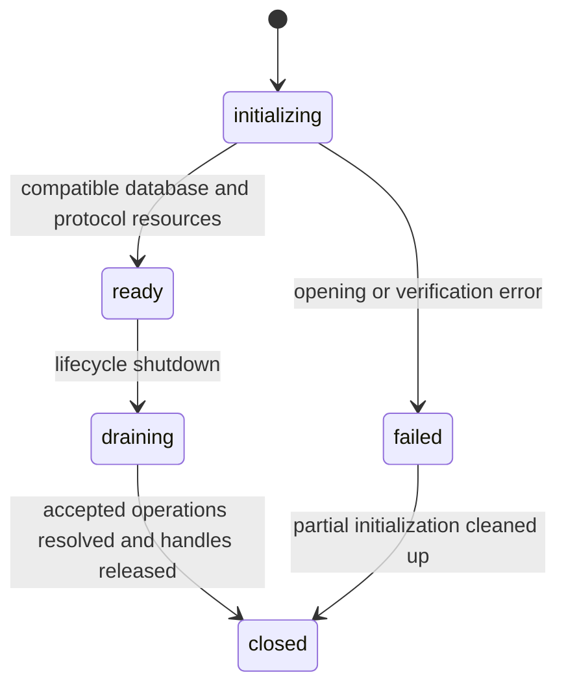
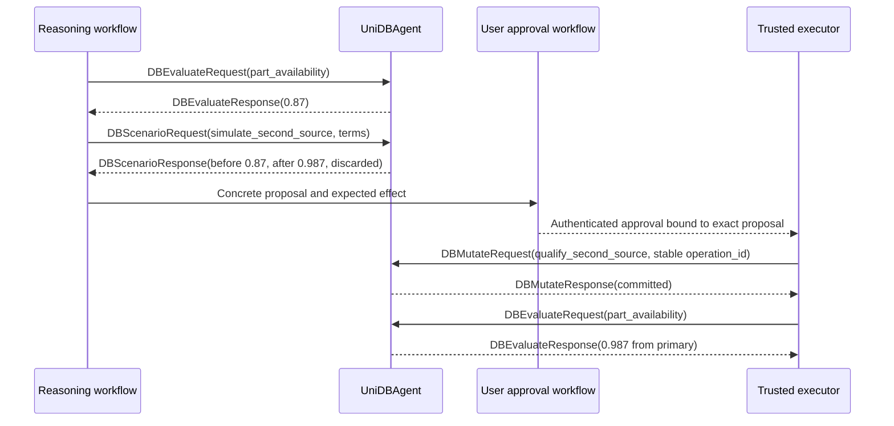

# Uni-DB agent: core design, initialization, and message protocol

**Status:** implemented for draft review, 2026-11-17. The v1 models and native runtime are in `unidb/`, pinned to Uni-DB 5.2.1 on Python 3.13. The three JSON cases now contain captured native result payloads. Internal IDs and commit versions are run-specific. The guild-denied exchange remains an application fixture, with its actual `send_error` delivery tested separately.

This evolves [Nihal’s PR 236](https://github.com/rustic-ai/rustic-ai/pull/236), retaining all 15 operation names while replacing its older `Database` API and wire shapes. No legacy adapters are provided. The [Agentic ERP book](https://github.com/milliondreams/erp_book) informs the business examples; its Uni-DB 3.4.0 observations are not compatibility guarantees.

Two agreed deferrals remain: scenario applicability checks and a general Rustic resource shutdown hook. Owners must explicitly call `UniDBResolver.close()` before guild shutdown. Message-driven cancellation, pinned/fork reads, remote storage certification, multiple write owners, and receipt retention are outside this initial supported surface.


## 1. Purpose and architectural boundary

`UniDBAgent` is a reusable, typed database execution capability. It stores and queries user-defined graph data, evaluates supplied logic, exposes native explanations, and executes bounded mutations and scenarios. It has no built-in accounting, procurement, memory-consolidation, or natural-language policy.

One configured database binding belongs to one agent instance. Each invocation gets a fresh session. Each ordinary atomic mutation request owns one transaction. Native handles, credentials, mutable sessions, transactions, cursors, and cancellation tokens remain inside the runtime; messages carry serializable identifiers and values.

| Concern | Core integration | User/application supplies |
| --- | --- | --- |
| Storage | Resolve binding, open handle, manage lifetime | Location, credentials, deployment, persistence requirements |
| Schema | Validate/translate supported definitions, inspect compatibility | Labels, edge types, properties, indexes, domain constraints |
| Operations | Parameter validation, execution, bounds, results | Named queries, mutations, checks, output contracts |
| Logic | Register/evaluate programs, preserve results and provenance | Rules, dependencies, assumptions, versions |
| Authority | No caller permission policy; validate delivered execution requests | Guild-owned access, authentication, approval policy, approver eligibility, response visibility |
| Scenarios | Isolated execution and cleanup | Hypothetical changes, evaluation objectives |
| Memory | Store arbitrary domain records through explicit contracts | Uniko owns cognitive memory semantics and its private store |
| Presentation | Typed facts, errors, metrics, explanations | Natural-language interpretation, reports, UI |

A reasoning agent can consume the same request contracts as a deterministic workflow. Its tool declarations should expose selected named operations, not automatically expose the entire administrative surface.

## 2. Components and ownership

| Component | Responsibility |
| --- | --- |
| `rustic_ai.unidb.agent.UniDBAgent` | Processor registration, database readiness, execution validation, correlated terminal results |
| `rustic_ai.unidb.resolver.UniDBResolver` | Resolve deployment configuration and construct/own a runtime |
| `UniDBRuntime` | Native handle, bounded session/transaction execution, receipts, explicit shutdown |
| `rustic_ai.unidb.models` | Public configuration and protocol models |
| Operation catalog | Versioned, user-supplied named execution definitions |
| Serializer | Explicit conversion of supported native results to protocol values |

Start with synchronous processors around synchronous `Uni`. This fits a sequential actor and avoids blocking calls hidden behind an `async` signature. A native async runtime is an extension with the same wire protocol, justified by measured execution requirements. Per-request bounds still matter when processing is sequential: one slow request can delay the actor's queue.

Use an agent-scoped typed runtime dependency named `unidb`. Resolver scope describes caching, not cross-process object sharing. One authoritative write owner is the initial supported deployment. Multiple agents resolving the same URI do not establish coordinated write ownership; independent native readers also need an explicit freshness strategy. Object storage is not permission to assume safe multi-writer deployment.

## 3. Initialization and readiness

### 3.1 Deployment configuration

The resolver owns:

- `binding_id`: stable logical name returned in responses.
- `open_mode`: `open_existing`, `create`, or `temporary`.
- `location`: configured filesystem binding or a separately supported native URI binding.
- `native_config`: supported engine settings, validated using the chosen native version.
- `bootstrap`: schema/rule definitions, a revision, and an explicit application policy.
- `receipts`: operation bookkeeping mode and reserved metadata namespace.

For a filesystem binding, resolve a relative path through the injected filesystem rather than the process working directory. Validate the backing filesystem and supported URI translation. The examples use a local `FileSystemResolver`; remote locations require their own tested native configuration, not copying Uniko's local-filesystem restriction.

Use `open_existing` by default in persistent deployments. `create` refuses an existing store. `temporary` is explicit disposable storage; native `in_memory()` uses a temporary filesystem and is not a pure-RAM durability mode. Never fall back to an empty or temporary database after an opening failure.

### 3.2 Agent configuration

Agent properties own database-ready admission, limits, raw-operation enablement, and the operation catalog. The catalog defines the capability offered by this instance; it does not grant caller permissions. Database paths and credentials are not request fields.

Capability families include `capabilities`, `health`, `query`, `evaluate`, `explain`, `mutation`, `scenario`, `operation_status`, and separately defined administrative/bulk families. Guild design owns which callers may invoke them, including operation allowlists, approval paths, and error/result audiences. Authentication and enforcement belong to the guild's application-provided boundary and transport configuration; a routing topic or model-provided identity is not authentication. UniDBAgent assumes that boundary has authorized delivered requests. Stable runtime attribution may scope receipts without becoming an agent-owned permission system.

The same database may need writes for a guild-authorized executor and scratch work for scenarios. The guild enforces caller profiles before delivery, rather than pretending a writable native handle is read-only. Use a native read-only handle when the entire deployed instance is read-only. Untrusted code must not receive the runtime object. Separate native read-only instances may be used when stronger process separation is required, with tested freshness behavior.

### 3.3 Startup sequence

1. Validate configuration, catalog definitions, parameter schemas, supported operation kinds, and resource bounds.
2. Resolve storage and validate bootstrap resources before opening a persistent store.
3. Open the native handle using the selected mode.
4. Observe native version and capabilities; validate required behaviors for the advertised surface.
5. Bootstrap or verify the supplied schema/rules according to policy.
6. Initialize the connector-owned receipt namespace and recover uncertain operations.
7. Publish database readiness and admit execution requests.



Rustic transport/agent readiness does not by itself prove database readiness. Implement eager runtime preparation before normal message admission, or an explicit database-ready gate if preparation is asynchronous. Health/discovery may describe initialization failure; data handlers must not run against a partially initialized binding. Startup failure needs a lifecycle-visible diagnostic even when no request is awaiting a reply.

### 3.4 Bootstrap policies

| Policy | Meaning |
| --- | --- |
| `verify_existing` | Confirm expected schema/rules and revisions; make no domain changes |
| `apply_to_new` | Initialize a newly created store from supplied definitions |
| Explicit administration | Apply supported changes to an existing store through separately authorized operations |

A bootstrap revision is an identifier, not proof of compatibility. Verify relevant native definitions and content digests. Do not silently replace rules or infer migrations. Administrative schema application, rule registration, and index work are not promised to be one atomic transaction. If bootstrap fails after partial application, record failure and require an explicit recovery decision rather than reapplying blindly.

Native `ext_id` is a reserved globally unique external identifier. The examples use prefixed values such as `product:digitizer`; they do not declare `ext_id` as an ordinary property or use local VIDs as business identifiers.

## 4. Versioned protocol

All public models use `protocol_version: 1` and reject unexpected fields. The namespace is `rustic_ai.unidb.models`. The native dependency is pinned to `uni-db==5.2.1`; no backward compatibility with PR 236 is provided.

### 4.1 Common request fields

| Field | Contract |
| --- | --- |
| `request_id` | Nonempty string identifying this invocation; retained in terminal replies |
| `correlation_id` | Nonempty string tying invocations to a larger workflow |
| `operation` | Configured catalog name for execution requests |
| `params` | Values validated against that operation's closed parameter schema |
| `limits` | Optional reductions of effective engine/delivery limits |
| `view` | Optional live selector; pinned/snapshot/fork selectors are refused in v1 |
| `operation_id` | Required for persistent effect requests; stable across retransmission |

No credential, native handle, arbitrary storage path, principal, approver, or arbitrary response address belongs in these payloads. Native envelope IDs, sender attribution, reply ancestry, tracing, and routing remain Rustic envelope fields. `request_id` is not a replacement for the envelope's message ID.

For v1 scenarios and mutations, the examples use the primary live binding. Snapshot/fork selection requires separate authorization and capability checks. Reject unsupported combinations explicitly, including pinned scenario behavior until it is verified against the supported native version.

### 4.2 Initial message families

| Request | Response | Semantics |
| --- | --- | --- |
| `DBCapabilitiesRequest` | `DBCapabilitiesResponse` | Protocol version, observed native features, configured operation surface; guild controls discovery access |
| `DBHealthRequest` | `DBHealthResponse` | Database lifecycle and readiness, configured durability, outstanding work |
| `DBQueryRequest` | `DBQueryResponse` | Named parameterized Cypher read |
| `DBEvaluateRequest` | `DBEvaluateResponse` | Named Locy evaluation; explicit command results, no durable materialization |
| `DBExplainRequest` | `DBExplainResponse` | Named native derivation explanation; no invented proof |
| `DBMutateRequest` | `DBMutateResponse` | Named bounded mutation sequence and checks in one transaction |
| `DBScenarioRequest` | `DBScenarioResponse` | Named hypothetical with before/after evaluations, discarded changes |
| `DBOperationStatusRequest` | `DBOperationStatusResponse` | Read operation bookkeeping without redispatch; guild controls access |
| Any rejected execution request | `DBFailure` | Correlated terminal failure or explicit uncertain-effect outcome |

Cypher plan explanation/profile is distinct from a Locy proof. Add a dedicated `DBQueryPlanRequest` when shipping that surface. Bulk loading, rule/schema changes, snapshots, fork promotion, indexes, and maintenance get dedicated administrative/load protocols; they are not hidden inside a generic execution request.

Raw Cypher interfaces are optional trusted developer surfaces with separate models. Locy programs are supplied in the catalog. V1 examples disable them. Native `Session.query()` is not a sufficient universal authorization classifier for every statement/procedure. Read-only catalog validation and native access controls must cover the actual supported language, including administrative or side-effectful commands. Do not implement this by checking whether a string starts with `MATCH`.

### 4.3 Catalog definition

A catalog entry has a name, kind, closed JSON parameter schema, execution definition, and optional expected columns/checks. A catalog revision and content digest identify what executed. Callers choose values, not execution text or the enforcement checks.

| Kind | Definition |
| --- | --- |
| `query` | Parameterized Cypher and expected projection columns |
| `evaluate` | Locy program, expected row-producing columns, permitted result kinds |
| `explain` | Fixed rule/key expression with parameterized key values |
| `mutation` | Bounded Cypher statements, pre/post checks, optional statement expectations |
| `scenario` | Isolation mode, before evaluations, hypothetical mutations, after evaluations |

The schema adapter accepts only explicitly supported property/edge/index definitions. The examples use string, int64 and float64 properties. Parameterized values are distinct from language identifiers: labels, property names, rule names, and operation bodies come from validated catalog definitions. No unchecked string interpolation is needed.

For mutation entries, all checks execute inside the same transaction as their statements. Each check declares `phase: pre` or `phase: post`; execute each phase in catalog order. Example checks support bounded row count, equality, and approximate numeric comparison with an explicit tolerance. These are closed assertion forms, not arbitrary Python or model-generated predicates. The domain supplies their meaning. Validate check ordering: prechecks precede mutations; postchecks follow them. Zero matches or unexpected mutation statistics can refuse a transaction rather than report a successful no-op.

### 4.4 Response shape and values

Responses preserve protocol/request/correlation IDs and the logical binding. Success responses have `outcome: succeeded`, a family-specific `result`, and metadata. Failure responses have `outcome: failed` or `unknown`, a structured error, and available metadata. A committed operation with ancillary warnings still reports its committed effect.

Query results expose `columns`, `rows`, `returned_count`, `truncated`, and `complete`. `returned_count` is not a total-match count. Locy results retain command order and distinguish query rows, explanation trees, abduction candidates, hypothetical results, and derived-fact sets. Never flatten every command to one list or treat an unvalidated candidate as an approved intervention.

For named evaluations, return the requested command outputs by default rather than every dependency's derived relation. Include rule program IDs/digests and any engine incompleteness warning. `allow_partial` is off initially. Native session-level `DERIVE` returns data for explicit application; transaction-level `DERIVE` can mutate the transaction. Durable application must have an explicit mutation contract.

Serialization is a maintained adapter, not `dir()`, `__dict__`, or `str()` fallbacks. JSON-safe numbers remain numbers; int64 values outside the interoperable JSON safe-integer range use a tagged decimal-string encoding. Bytes use a tagged base64 encoding, temporal values use tagged canonical values, and supported graph values preserve identity/type/properties deliberately. Exact example cents fit the safe range. Reject unsupported values visibly, and preflight write result serialization before commit where possible.

Proof trees are native evidence. A proof is valid for the read view and rule program used, not automatic historical evidence. Preserve actual native structure through the serializer. If too large, use an explicitly supported artifact reference or report truncation; never trim bytes into invalid JSON or claim an incomplete proof is complete. Empty explanations return `no_derivation`, not a proof of zero or absence.

### 4.5 Limits and provenance

Server limits cap request size, statement count, timeout, engine memory, rows, and encoded output bytes. A request can reduce limits but cannot expand them. Query limits reach native builders/cancellation tokens; output caps alone do not bound computation. Reads may fetch at most an additional row to establish truncation where cursors permit it. Do not append `LIMIT` to arbitrary text and assume aggregates, plans, or nested results are bounded.

Report catalog/rule identities, live versus pinned views, and native versions actually observed. A recorded snapshot name does not mean a read was pinned. Do not invent a read revision if the native operation cannot expose it. Commit responses can include observed native commit version, mutation statistics, promoted rules, and rule-promotion errors. Column/result normalization does not erase warnings.

Large output streaming or artifact transport is an extension requiring a complete framing/resumption contract. The initial bounded inline protocol must fail or explicitly truncate according to the operation contract rather than silently dropping data.

## 5. Execution, receipts, failures, and shutdown

### 5.1 Ordinary reads and mutations

Guild boundary: authenticate/authorize and route the request → deliver to the database agent, or emit a typed access error through `send_error`.

Agent read: validate envelope/payload → resolve catalog → validate parameters/limits → create session/view → execute → serialize bounded result → emit terminal reply → release resources.

Agent mutation: validate delivered request → resolve stable operation identity → check/claim receipt → create session/transaction → run prechecks → execute statements → run postchecks → prepare serializable result/receipt → commit → confirm outcome → emit terminal reply → release resources.

Statement success is provisional. Exceptions or failed checks before commit roll back the entire ordinary batch. Do not use native bulk writers to implement this atomic request: bulk loading has its own load identity and incomplete/unknown commit outcomes.

Commit durability and L1 flush differ. With WAL enabled, report the native commit rather than flushing every request by default. A post-commit flush, publication, or serialization error does not turn a committed effect into `rolled_back`. Report the established effect and a recoverable receipt/status path. WAL-disabled operation must expose reduced durability honestly.

### 5.2 Operation identity and recovery

Receipt identity is `(binding, trusted caller, operation_id)`. Its fingerprint includes operation kind/name, normalized parameters, target view, and relevant catalog/rule/check content identities. Invocation/correlation IDs and tracing are excluded; retries need their new invocation IDs in the replayed response while retaining the original effect identity. Catalog changes under the same operation ID conflict rather than execute a new definition.

Ordinary writes use the connector-owned `RusticUniDBOperation` label and `__rustic_unidb:` external-ID prefix. A durable pending claim is committed before executing the domain transaction. The completion record and prepared result are updated in the same transaction as the domain effect. A per-runtime lock serializes invocations; globally unique native external IDs protect claim creation. This supports one authoritative write owner. Catalog authors and trusted raw/admin callers must preserve this reserved metadata; it is not an authorization boundary against arbitrary Cypher.

A completed receipt is authoritative when commit reporting or response publication fails. Replay returns the prepared domain result with `replayed: true`; the original native commit-only metadata was unavailable before commit and is not reconstructed (`commit.metadata_available: false`).

| Receipt state | Behavior |
| --- | --- |
| Unseen | Admit only after acquiring the durable claim appropriate to the receipt design |
| In progress | Return current state; do not start another execution |
| Completed, same fingerprint | Return established result with `replayed: true` and current invocation IDs |
| Existing, different fingerprint | `operation_id_conflict`; no effect |
| Uncertain after dispatch | `operation_outcome_unknown`; inspect/resolve, never blindly rerun |

An unresolved pending record is reported as `unknown`, not blindly reexecuted. Known rollback records permit another attempt with the same fingerprint. Changed fingerprints are refused. Receipt status is scoped by binding, runtime sender attribution, and operation ID; attribution does not grant permission.

DDL, index work, flush, and bulk loading use a separate journal around native effects, so their bookkeeping is not atomic with those effects. Bulk loading records the native load ID before applying data and uses `bulk_load_applied` for reconciliation. A native applied load is reported as committed even if reporting fails. Ambiguous admin/bulk work is never automatically repeated.

Only bounded, known retryable conflicts may retry a whole transaction after rollback, using the same operation identity. Default automatic conflict retries are zero. Never retry an ambiguous commit. Receipt retention is tied to the promised retry window; backup/restore must retain bookkeeping with the domain store. Operation-status reads are authorized to the caller's scope.

### 5.3 Structured failures

`DBFailure.error` contains `code`, `stage`, `retryable`, `effect`, `message`, and bounded `details`. `effect` describes persistent mutation effects: `not_started`, `rolled_back`, `committed`, or `unknown`; it does not claim that no read was evaluated. Typical codes include invalid request/parameters, unavailable binding, capability denied, unknown operation, constraint conflict, check failure, native conflict/timeout/cancellation, no derivation, incomplete evaluation, serialization failure, operation ID conflict, and unknown outcome.

Expected execution failures are emitted through `ctx.send_error(DBFailure(...))`, retaining the typed payload's request/correlation IDs, error code, and effect state. `DBFailure` is the database-specific error type. Current `send_error` accepts any Pydantic model and preserves its format; it does not wrap it in the generic `ErrorMessage`. Emit the error once through this API, rather than also emitting a normal failure response.

Rustic always adds delivery to `GuildTopics.ERROR_TOPIC` (`error_topic`). Matching routing-slip rules can produce additional deliveries, so error consumers must tolerate duplicate delivery. The examples omit explicit DBFailure output routes and show the default error-topic projection. Error publication does not itself assign terminal `process_status: error`: the guild error-handling flow decides whether to recover, continue reasoning, or end the workflow. Subscribe the guild's error handler/probe to the error topic. Guild access rejections use the same API from the access boundary before delivery to UniDBAgent. Framework-level unhandled exceptions remain diagnostics and need an application error consumer. No path should emit a success response followed by a contradictory failure.

Exactly one logical outcome per accepted invocation is the contract. It is not an exactly-once wire-delivery guarantee or automatic termination of the enclosing workflow. Receipts and caller-side event identities handle repeated delivery. A rejected malformed native envelope may fail before a processor can extract request IDs; boundary validation needs a diagnostic path without inventing correlation.

### 5.4 Scenario lifecycle

The initial scenario mode uses a native scratch transaction when that combination of supplied operations and registered rules is verified. It evaluates baseline facts, applies hypothetical mutations, evaluates results, and rolls back before returning success. Native scratch commit refusal is an additional boundary; it does not replace cleanup. Scratch data never reaches primary business state.

Do not silently fall back from scratch to ordinary commit-capable transactions or durable forks. A future managed-fork mode needs explicit creation, ownership, expiry, cleanup, and permitted promotion. Snapshot/pin/fork/registry interactions are tested capabilities, not inferred from their names. Scenario output describes modeled consequences under supplied assumptions, not a calibrated promise about the world.

### 5.5 Cancellation and shutdown

Cancellation is cooperative and scoped to an authorized request identity. It cannot undo a completed commit. A sequential actor cannot service a cancellation message while blocked in the same long-running handler; live cancellation therefore needs a separate control path or native deadline mechanism. Do not advertise message-driven cancellation until that path is tested.

The explicit runtime close acquires the execution lock, moves through draining, and shuts down the native handle. Cleanup is idempotent after success. `UniDBResolver.close()` closes its cached runtimes. Integration with a general Rustic lifecycle hook is deliberately deferred, so guild shutdown alone does not guarantee native cleanup. The embedding owner must close the resolver; health reports `shutdown_hook_integrated: false`.

## 6. Examples: initialization, usage, and message I/O

Each example has a complete database-agent GuildSpec and a message-exchange fixture. The fixture supplies client identities and result projections; it is not a full native `Message` dump or a standalone deployed application. Caller/probe agents and their request routes are provided by the embedding application/test harness.

| Case | Initialization | Message exchanges |
| --- | --- | --- |
| 1. Atomic supply graph | [supply-network-init.json](uni-db-agent-examples/supply-network-init.json) | [supply-network-messages.json](uni-db-agent-examples/supply-network-messages.json) |
| 2. Derived receivables | [receivables-init.json](uni-db-agent-examples/receivables-init.json) | [receivables-messages.json](uni-db-agent-examples/receivables-messages.json) |
| 3. Supplier scenario and approved execution | [supplier-scenario-init.json](uni-db-agent-examples/supplier-scenario-init.json) | [supplier-scenario-messages.json](uni-db-agent-examples/supplier-scenario-messages.json) |

All three initialize new local databases, enable WAL and strict schema, apply explicitly supplied schema/rules, declare the receipt namespace, disable raw operations, and use bounded inline results. GuildSpec `properties.example_guild_policy` records the examples' guild-owned profiles/allowlists; this is an illustrative application annotation, not built-in Rustic enforcement. The embedding guild must implement the boundary and control transport access before exposing the database. They use stable prefixed external IDs. The filesystem resolver produces an organization/guild/agent-scoped path below `/tmp/rustic-unidb-design-examples`. These are disposable demonstrations; persistent deployments replace the location and choose `verify_existing`/`open_existing` where appropriate. Re-launching a `create` example against an existing path fails by design.

### 6.1 Common initialization and send usage

With the package installed, a development harness can load a spec using the current Rustic builder API:

```python
import json
from pathlib import Path

from rustic_ai.core.guild.builders import GuildBuilder
from rustic_ai.core.guild.dsl import GuildSpec

path = Path("docs/design/uni-db-agent-examples/supply-network-init.json")
spec = GuildSpec.model_validate(
    json.loads(path.read_text()), context={"require_agent_class": True}
)
builder = GuildBuilder.from_spec(spec)
# Add caller/probe AgentSpecs and request routes before launching below.
```

Strict class validation now passes for all three initialization specs and the showcase. Run all three native cases without an LLM from the repository root:

```bash
PYTHONPATH=unidb/src python unidb/examples/run_examples.py
```

The runner opens fresh disposable local stores, prints captured response projections, and explicitly closes each runtime. Actual guild delivery, typed errors, default-topic filtering, replay, and the example access boundary are covered by the integration tests.

For a caller emitting the first request, add a recurring output route to `db.requests` and include that caller in the guild. The route matches the producer, not the destination agent:

```python
from rustic_ai.core.guild.builders import RouteBuilder
from rustic_ai.core.messaging import AgentTag
from rustic_ai.unidb.models import DBMutateRequest

entry_route = (
    RouteBuilder(AgentTag(id="demo-ingester", name="demo-ingester"))
    .on_message_format(DBMutateRequest)
    .set_destination_topics("db.requests")
    .set_route_times(-1)
    .build()
)
builder.add_route(entry_route)
# After adding all required caller/probe AgentSpecs and their request routes:
guild = builder.launch(organization_id="demo-org")
# Production lifecycle uses the managed bootstrap path instead of this demo launch.
```

Add equivalent request routes for each caller/family it uses. A test client can instead publish the fixture request projection directly to `db.requests` through the actual messaging boundary. The initialization files route successful database response families to `db.results` with recurring rules; a probe/caller must subscribe there, and an error consumer must subscribe to `GuildTopics.ERROR_TOPIC`. The shared result topic is a demonstration topology; the embedding guild owns result visibility and trusted return paths. Application presentation/error routes decide whether a result completes the larger user workflow. A completed database call is not necessarily a completed user task.

Inside an existing caller processor, the fixture payload can become a typed request:

```python
import json
from pathlib import Path

from rustic_ai.unidb.models import DBMutateRequest

def submit_supply_import(ctx):
    fixture = json.loads(
        Path("docs/design/uni-db-agent-examples/supply-network-messages.json")
        .read_text()
    )
    request = fixture["exchanges"][0]["request"]
    ctx.send(DBMutateRequest.model_validate(request["payload"]))
```

`ctx` is the real caller's `ProcessContext`; this helper does not create or impersonate a sender. Fixture sender IDs stand for authenticated harness identities. Clients consume `ctx.payload`/typed response models rather than expecting the agent to return a Python value from the handler.

### 6.2 Case 1: atomic supply-network ingestion and query

**Outcome:** a product, two suppliers, and their sourcing relationships become visible together; the caller then reads the supplied commercial data. This is domain graph storage, not cognitive-memory ingestion.

**Initialization:** `Product(name)`, `Party(name)`, and `SUPPLIES(reliability, unit_cost_cents, lead_time_days)`. The catalog supplies `register_supply_network` and `suppliers_for_product`. The import creates three nodes and two relationships through three ordinary Cypher statements in one transaction. Amounts are exact cents; a currency/UoM model would be supplied by a richer application.

**Flow:** ingester → `DBMutateRequest` → committed `DBMutateResponse`; reasoner → `DBQueryRequest` → `DBQueryResponse`; ingester retries with a new request ID and the same operation ID → replayed receipt. A changed payload under that operation ID is refused before any write.

The query payload is:

```json
{
  "protocol_version": 1,
  "request_id": "req:suppliers-read:001",
  "correlation_id": "workflow:supply-import:001",
  "operation": "suppliers_for_product",
  "params": {"product_id": "product:digitizer"}
}
```

The result has two rows: Allied Circuits at reliability `0.90`, cost `1850` cents, lead time `14`; Shenzhen Electronics at `0.87`, cost `1800` cents, lead time `7`. `returned_count` is `2`, `truncated` is false, and the view is live. The fixture contains the complete import payload and response envelope projections.

**Acceptance:** failed statement/check/constraint before commit leaves none of the imported batch; committed receipt replay creates no additional nodes/edges; changed fingerprint conflicts; a post-commit publication failure can be recovered through operation status/replay. Do not implement the import with a bulk writer while retaining these rollback claims.

### 6.3 Case 2: derive and explain a receivable balance

**Outcome:** compute an invoice's outstanding amount from recorded payment facts, and return a native explanation without storing a redundant balance/status field.

**Initialization:** `Invoice(amount_cents)`, `Payment(amount_cents)`, and `APPLIES_TO`. The supplied rules sum linked payments and derive invoice balance, with a separate keyed clause for an invoice with no payment. The catalog defines `record_invoice_payment`, `invoice_balance`, and `explain_invoice_balance`.

The core rule pattern is user supplied:

```locy
CREATE RULE payment_total AS
  MATCH (payment:Payment)-[:APPLIES_TO]->(invoice:Invoice)
  FOLD paid_cents = SUM(payment.amount_cents)
  YIELD KEY invoice, paid_cents

CREATE RULE invoice_balance AS
  MATCH (invoice:Invoice)
  WHERE invoice IS payment_total
  YIELD KEY invoice, invoice.amount_cents - paid_cents AS balance_cents

CREATE RULE invoice_balance AS
  MATCH (invoice:Invoice)
  WHERE invoice IS NOT payment_total
  YIELD KEY invoice, invoice.amount_cents AS balance_cents
```

This is nonrecursive aggregation. KEY placement makes negation about invoice identity. The example is not a complete AR subsystem: currencies, credit notes, payment allocation controls, dates, and fiscal-period policy would be domain additions.

**Flow:** record invoice `25000` cents and linked payment `10000` cents atomically → evaluate the named rule → explain that invoice key. Usage from a caller:

```python
from rustic_ai.unidb.models import DBEvaluateRequest

def request_balance(ctx):
    ctx.send(DBEvaluateRequest(
        protocol_version=1,
        request_id="req:invoice-balance:1001",
        correlation_id="workflow:receivable:1001",
        operation="invoice_balance",
        params={"invoice_id": "invoice:1001"},
    ))
```

The evaluation result contains one query command with columns `invoice_id`, `balance_cents` and row `{"invoice_id": "invoice:1001", "balance_cents": 15000}`. `materialized` is false. It retains the rule-program identity and read-view metadata.

The explanation request selects the configured `explain_invoice_balance` operation with the same key. Its response reports a found derivation and serialized native proof. The fixture contains the engine's captured proof tree, including tagged native identifiers. Uni-DB 5.2.1 does not propagate builder parameters into EXPLAIN filters; the adapter binds only scalar values in fixed catalog programs using JSON literals while leaving quoted strings and comments intact. It does not interpolate arbitrary request programs. A missing key returns `no_derivation`; it is not interpreted as a zero balance.

**Acceptance:** exact cents arithmetic; unchanged stored facts after evaluate/explain; no-payment and multiple-payment cases; missing-key distinction; warnings/incompleteness retained; rule revision and read view are correct. Current-state proofs do not establish what was reported in a closed historical period.

### 6.4 Case 3: simulate a second source, then execute an approved change

**Outcome:** compare a specific sourcing change against the baseline, obtain domain approval outside the database agent, commit through an authorized executor, and verify the committed result freshly.

**Initialization:** two parties and one digitizer product; only the primary supplier initially has a `SUPPLIES` edge. The edge carries reliability, exact cost cents, lead time, and minimum quantity. Supplied Locy folds Noisy-OR over supplier reliability:

```locy
CREATE RULE part_availability AS
  MATCH (part:Product)<-[supply:SUPPLIES]-(supplier:Party)
  FOLD availability = MNOR(supply.reliability)
  YIELD KEY part, availability PROB
```

The catalog includes seed, baseline evaluation, scratch simulation, and qualification mutation operations. Guild-owned operation allowlists separate the ingester, reasoner, and approved executor; the guild boundary prevents the ingester from invoking supplier qualification. The scenario assumes the candidate supplier already exists as a domain record.

Human-supplied candidate terms are:

```json
{
  "product_id": "product:digitizer",
  "supplier_id": "supplier:allied",
  "reliability": 0.90,
  "unit_cost_cents": 1850,
  "lead_time_days": 14,
  "min_order_qty": 500
}
```

**Flow:**



The scenario request uses `operation: simulate_second_source`, those parameters, a request ID, and correlation `workflow:second-source:001`. The response separates `before` and `after`, reports scratch isolation, `persisted: false`, and cleanup completion. The primary still has one supplier edge after simulation.

The modeled result is `1 - (1 - 0.87) * (1 - 0.90) = 0.987`. Independence is a supplied model assumption, not something the database or LLM proves. The catalog supplies the scenario warning, copied to the result with `source: application_catalog`, a code, and a message; it must not be presented as a native engine diagnostic. Engine warnings use their own source attribution. This example concerns part availability, not a full assembly's probability, quantity exposure, or correlated supply failure.

The user-provided approval workflow binds action, arguments, evidence, expected effect, and freshness policy. It authenticates the approver and applies business eligibility/four-eyes/SoD requirements where relevant. Its example is recorded in the fixture's `external_workflow`, not a UniDBAgent request family. An `approval_id` inside arbitrary model parameters confers no capability.

The trusted executor submits `DBMutateRequest` with `operation: qualify_second_source`, the approved terms, and `operation_id: op:approved-qualification:001`. Prechecks confirm the selected endpoints and absence of an existing sourcing edge; statement expectations require one relationship created. The postcheck verifies modeled availability approximately `0.987` inside the transaction, then commit and receipt become visible together. The postcheck is deliberately specific to this example's supplied terms; a general domain package would define its own goals and tolerances.

Afterward, a new `DBEvaluateRequest` reads committed primary data. A failed post-commit verification cannot retroactively roll back the business write; a correction would be another authorized operation. In the denied-call fixture, the reasoner submits to `db.access.requests`; the application-provided `demo-access-boundary` emits `capability_denied` with `effect: not_started` through `send_error`. The request never reaches UniDBAgent.

Usage from the reasoning caller is:

```python
from rustic_ai.unidb.models import DBScenarioRequest

def price_second_source(ctx, human_terms):
    ctx.send(DBScenarioRequest(
        protocol_version=1,
        request_id="req:second-source-scenario:001",
        correlation_id="workflow:second-source:001",
        operation="simulate_second_source",
        params=human_terms,
    ))
```

**Acceptance:** the supplied rule works inside scratch; baseline/after reads have the documented view semantics; scratch commit is refused; cleanup occurs on success/error/cancellation; no primary change after simulation; unauthorized writes fail before native dispatch; approved arguments remain exact; checks/mutation/receipt are atomic; fresh verification reads primary state. Approval authentication and correctness require domain-workflow tests beyond database-agent tests.

## 7. Implementation plan and acceptance evidence

| Stage | Deliverable | Evidence required |
| --- | --- | --- |
| A. Protocol/runtime foundation | Models, serializer, resolver, startup/health/capabilities, bounded queries | Strict configuration validation, actual readiness failure, native query bounds, supported value serialization |
| B. Atomic writes and recovery | Named mutation/check execution, receipt/status protocol | Rollback, committed replay, changed fingerprint, injected crash/ambiguous commit, publication failure, reopen |
| C. Logic and explanation | Registered rules, named command results, proof adapter | Exact receivable outputs, no unintended materialization, no-derivation, warning/proof bounds |
| D. Scenarios | Verified scratch lifecycle | Primary unchanged, registered-rule visibility, cleanup, pinned combination rejection, cancellation |
| E. Extensions | Bulk/admin/search/managed forks/raw developer surfaces | Separate capability and outcome gates for each |

Exercise the real `@processor` selection and `ctx.send` route path with callers/probes, including default-topic filtering, recurring routes, duplicated requests, error delivery, and late results. Handler-only tests do not establish broker delivery or managed startup. Restart tests reopen the native store and receipt state. Native engine invariants are checked against the supported wheel rather than a version label alone.

Do not introduce an LLM dependency to test these three cases. Expected arithmetic, checks, execution, and routing are deterministic. A later LLM facade should be measured separately for operation selection and interpretation; its model behavior is not proven by deterministic database replay.

### Supported boundaries

The implementation covers all 15 PR operations: label/edge creation, property addition, scalar/vector indexing, label/edge/schema inspection, raw Cypher query/execute, flush, vector search, and native vertex/edge bulk loads. Raw Cypher is disabled by default. `DBBulkStatusRequest` exposes native load reconciliation. The optional `tools` extra supplies argument-only LLM schemas, assigns protocol IDs outside the model, preserves actual provider tool-call IDs and ToolMessage history, and routes uncertain writes to reconciliation instead of automatic reasoning retries.

Native tests establish rollback, receipts after reopening, injected commit-reporting failures, interrupted admin/bulk work, bounded output rollback, no-payment/multiple-payment arithmetic, native proof shape, scratch rollback and commit refusal, configuration/readiness failure, and read non-materialization. Real guild tests cover message selection/routes and publication failures. The showcase runs with a scripted LLM to check the tool protocol; this does not establish real-model operation selection or business approval correctness.

Scenario applicability checks and the general shutdown lifecycle hook remain explicitly deferred. Existing-store bootstrap verifies expected property definitions and the connector's recorded rule-program digest, then compiles supplied text without replacing registered rules. It does not independently detect out-of-band registry changes. Remote URI backends, multi-owner receipt coordination, retention, pinned/fork reads, external artifact transport, and live cancellation need separate implementation evidence before advertisement.

## 8. Sources and validation boundary

Rustic contracts: [`Agent` and `ProcessContext`](../../core/src/rustic_ai/core/guild/agent.py), [`AgentSpec`/`GuildSpec`](../../core/src/rustic_ai/core/guild/dsl.py), [builders](../../core/src/rustic_ai/core/guild/builders.py), [dependency resolver](../../core/src/rustic_ai/core/guild/agent_ext/depends/dependency_resolver.py), [current Uniko integration](../../uniko-agent/README.md), and [ReAct design](react-agent-design.md).

Native contracts: [Uni-DB](https://github.com/rustic-ai/uni-db), especially `bindings/uni-db/uni_db/__init__.pyi`, session/transaction/builders, and `test_bulk_commit_outcome.py`. Native APIs and all three example Locy/Cypher flows are exercised against the supported wheel.

Domain inspiration: [Agentic ERP agent interface](https://github.com/milliondreams/erp_book/blob/main/erp_book/book/part5-agentic-layer/ch22-agent-interface.md), [tool contract](https://github.com/milliondreams/erp_book/blob/main/erp_book/book/part5-agentic-layer/ch21-composing-domains.md), and [scope limits](https://github.com/milliondreams/erp_book/blob/main/erp_book/book/appendices/h-what-meridian-is-not.md). REA's word “agent” denotes a participating business actor; it is not automatically an AI agent.

Validation on 2026-11-17 uses native integration tests plus strict Pydantic/GuildSpec class validation. All six JSON files load; all 14 exchanges are covered across the native examples and the guild boundary test. The guide and examples remain application building blocks: guild authentication, approval correctness, production transport, and real LLM behavior require deployment-specific validation.
