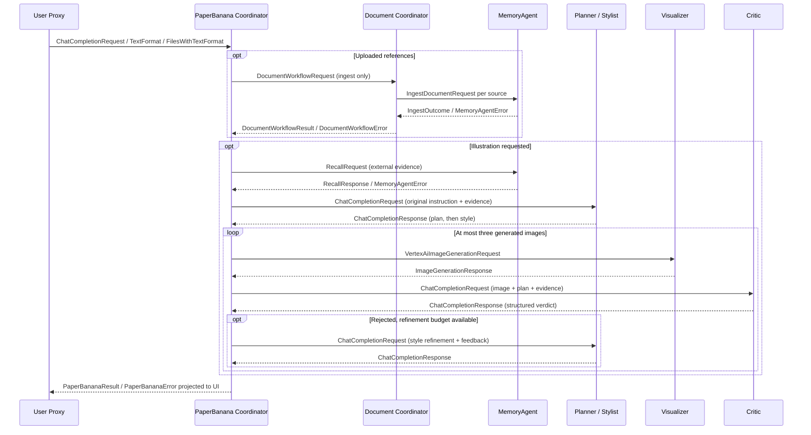

# PaperBanana: references to reviewed illustrations

[PaperBanana v2](https://github.com/milliondreams/rustic-ai/blob/main/showcase/apps/paper_banana_guild.json) composes Uniko document memory with planning, styling, image generation and critique. The application coordinator owns the workflow; the document coordinator accounts for each upload, and MemoryAgent stores and recalls external evidence. Plans, style prompts and critique are transient application state rather than corpus records.

## Composition



The seven internal agents subscribe to explicit topics. The existing planner, stylist, visualizer and critic IDs remain stable. The guild's routes connect typed messages; the coordinator never calls another agent directly.

## Three complete input paths

### Describe a diagram

Send `rustic_ai.core.guild.agent_ext.depends.llm.models.ChatCompletionRequest` through the User Proxy, or publish directly to `paperbanana.requests` with the guild routing slip:

```json
{
  "messages": [
    {"role": "user", "content": "Illustrate the Harbor project's budget and responsibilities."}
  ]
}
```

The latest user message supplies the original instruction. The coordinator recalls from the configured reference corpus, then sends bounded evidence to the planner. Empty recall is an explicit no-evidence mode; the planner can still produce an illustration. A recall error ends the workflow. Earlier chat messages do not replace the current instruction.

### Store uploaded references

```json
{
  "messages": [{"role": "user", "content": [
    {"type": "file_url", "file_url": {
      "url": "uploads/harbor.pdf",
      "filename": "harbor.pdf",
      "mime_type": "application/pdf",
      "source_id": "reference:harbor"
    }},
    {"type": "file_url", "file_url": {
      "url": "uploads/notes.md",
      "filename": "notes.md",
      "mime_type": "text/markdown",
      "source_id": "reference:notes"
    }}
  ]}]
}
```

These relative paths refer to files already staged in the guild filesystem. Studio upload replies of the form `/rustic/api/guilds/{guild_id}/files/{encoded_filename}` and guild-root `file:///uploads/harbor.pdf` links are also supported. The acquisition adapter verifies the guild ID, decodes transport filenames and rejects traversal. Plain absolute host paths must be inside the configured guild filesystem root. The coordinator normalizes each attachment and waits for all ingestion outcomes. It returns an upload summary without running the illustration agents. Stored archival files can be successful while unsearchable; the summary reports stored, searchable, failed and unknown separately. Deduplicated ingestion reports no newly created chunks, so MemoryAgent checks the existing artifact for searchable chunks. Repeated searchable uploads remain usable, while repeated blank archival PDFs remain unsearchable. Complete ingestion failure is a typed terminal error.

### Upload and request an illustration

Add a text part to the same upload message:

```json
{"type": "text", "text": "Illustrate the Harbor budget using these references."}
```

The coordinator ingests first and recalls only the successful, stored, searchable uploaded source IDs. Partial upload failure is allowed when another uploaded source supplies usable evidence. Previously stored corpus material cannot conceal total failure of the current uploads. If no uploaded source is searchable, or scoped recall returns no evidence, the workflow ends before planning.

Filenames, MIME types and logical source IDs survive staging. Inline `file_data` data URLs and UI `FilesWithTextFormat` uploads are also supported. HTTP/HTTPS uploads use the configured acquisition dependency described below.

## Initialization and deployment

Install the showcase and its declared dependencies, then load the blueprint's `spec` using `GuildBuilder.from_spec`. Studio supplies the User Proxy entry point; a direct bus caller includes `guild_spec.routes` when publishing to `paperbanana.requests`.

The checked-in guild selects:

- `PaperBananaCoordinatorAgent` with `corpus_session_id: corpus:paperbanana:references`.
- `DocumentCoordinatorAgent` with the same corpus and `memory_agent_id: memory_agent`.
- `MemoryAgent` with explicit producer policy for external evidence.
- A private guild filesystem rooted at `/tmp/paperbanana_data`, and `UnikoResolver` with `storage_path: paperbanana.db`, `streaming: false`.
- The existing LLM dependency and Vertex AI image agent. Configure the providers required by those agents before using hosted generation.

For durable deployment, select a durable private volume and preserve organization ID, guild ID and corpus ID across restart. Uploaded bytes and native document identities persist; active illustration workflows and completed-request tombstones are in memory. Restart does not resume an unfinished illustration. Resubmit it as a new request, keeping the logical source IDs and original bytes for native deduplication.

Both coordinator corpus settings must agree. Routing, producer policy, credentials and filesystem/network access are guild/deployment choices.

### HTTP upload policy

The default `HttpUploadSourceResolver` has `allowed_origins: []`. Configure exact origins of your upload service, including nondefault ports:

```json
"upload_reader": {
  "class_name": "rustic_ai.showcase.paper_banana_sources.HttpUploadSourceResolver",
  "properties": {
    "allowed_origins": ["https://uploads.example.org"],
    "headers": {}
  }
}
```

Credentials belong in dependency configuration supplied securely at launch. They are not request fields. The reader validates every redirect against the allowed origins, follows at most three redirects, forwards configured headers only to the original origin, disables implicit response cookies, streams within the remaining byte budget, and respects the absolute workflow deadline. Each acquisition writes a distinct staging file; concurrent identical uploads cannot truncate another workflow's snapshot. An acquisition timeout before the workflow deadline marks that source failed and allows usable sibling sources to continue. Content-Disposition and Content-Type provide filename and MIME defaults. URLs in outcome attribution omit user information, query strings and fragments; signed query credentials are not sent to the planner.

### Bounds and refinement

`PaperBananaConfig` defaults to 32 uploads, 16 MiB per source, 32 MiB per workflow, 32 active requests, 1,024 completed-request tombstones and a 600-second absolute deadline. Recall is bounded to three items, 6,000 characters and 2,000 estimated tokens. Planner, stylist and critic outputs are capped at 16,000, 12,000 and 4,000 characters respectively.

The critic must return JSON matching `PaperBananaCritique`:

```json
{"verdict": "reject", "feedback": "Label the currency and improve spacing."}
```

Approval completes with the image. Rejection refines the style using the original instruction, plan and feedback. The default two refinements permit at most three images; exhaustion emits `refinement_exhausted`. Invalid JSON, truncated output and provider failures are terminal. No placeholder image is presented as success.

## Outputs and correlation

Public typed outcomes are available on `paperbanana.outcomes`:

| Format | Fields | Status |
| --- | --- | --- |
| `rustic_ai.showcase.paper_banana_models.PaperBananaResult` | `request_id`, `kind`, `instruction`, per-source `sources`, optional `image` and `critique` | `completed` |
| `rustic_ai.showcase.paper_banana_models.PaperBananaError` | `request_id`, `error`, `message`, per-source `sources` | `error` |

`kind` is `upload_summary` or `illustration`. An illustration requires an image and an approving critique. Source outcomes include original index/name/MIME/URI, immutable source/revision/record IDs, status and native ingestion outcome. See the [document contracts](../agents/uniko/documents.md) for stored/searchable semantics.

Separate routes project these contracts onto `user_message_broadcast`: an upload/error `TextFormat`, or an approved `ImageFormat` with instruction and honest source counts. Each request produces one terminal presentation.

Internal context carries request ID, attempt, stage, iteration and an epoch-millisecond deadline. Control fields precede caller metadata so bounded compaction preserves them. Replies must match these fields and the expected agent sender. Duplicate input/outcomes and stale refinement/image replies are suppressed. Independent timers produce a terminal timeout even during blocked acquisition or an already running provider call; pending source outcomes become unknown. The coordinator validates dispatch after preparing its context, and guild entry predicates reject messages delivered after the deadline before document, memory, LLM or image work begins. Preserve these predicates when customizing the blueprint. Distributed deployments require synchronized host clocks for the deadline gate. Provider work that already began may finish, but its late response cannot advance the workflow. Context is compacted before forwarding and excludes attachment bodies, serialized `enriched_history` and known credential fields.

## Local verification

From the repository environment:

```shell
pytest showcase/tests/paper_banana -q
```

The tests execute the shipped routing slip with existing LLMAgents and deterministic LLM/image dependencies. Real native Uniko tests cover text-bearing and blank PDFs, current-upload scoping, persistence after reopen and reupload deduplication on sync and threaded engines. Regression tests cover actual Studio upload URLs and encoded filenames, repeated PDF readiness after reopen, concurrent identical staging, early source timeouts, large-context correlation, and delayed ingestion/planner/renderer dispatch on sync and threaded engines. Local HTTP tests cover acquisition, metadata, signed URLs, header/cookie isolation across redirect origins, byte bounds and timeout. No hosted LLM or image calls are needed for this suite.

Phase 2 replaces PaperBanana's KnowledgeAgent usage. Phase 3 migrates the [Semantic Memory Assistant](semantic_memory_assistant.md). Legacy LanceDB retirement and deployed data cutover remain separate phases.
