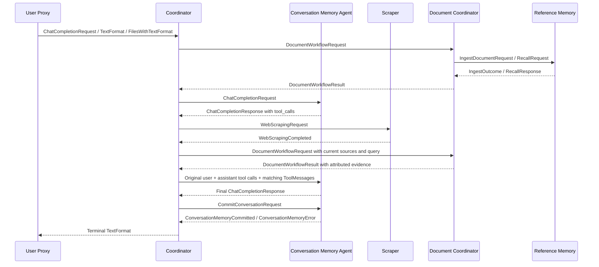

# Semantic Memory Assistant

The v2 [blueprint](https://github.com/milliondreams/rustic-ai/blob/main/showcase/apps/semantic_memory_assistant.json)
combines private conversation memory with a guild-shared document corpus. A
coordinator preserves the original question while independent LLM, scraper,
document coordination and memory capabilities exchange typed messages.



## Initialization and ownership

Install the showcase, Uniko, LLM, LiteLLM and Playwright packages. Configure the LLM
resolver for your deployment and install the Playwright browser. Select a private,
persistent local filesystem, a stable guild ID and the shipped stable agent IDs.
The Uniko resolver uses `semantic-assistant.db`; the conversational assistant and
reference MemoryAgent own separate native stores under their own identities.

The conversation wrapper scopes memory to the trusted User Proxy identity and
guild. The coordinator establishes that identity at the proxy entry boundary and
preserves forwarding metadata through every model invocation and accepted commit.
Do not publish client-provided user tags directly to internal topics. Guild design
owns access controls, credentials, storage policy and acquisition permissions.

Web and uploaded document evidence is shared across users of the same guild in
`corpus:semantic-assistant:references`. Conversation assertions and assistant
answers remain private. Keep these storage identities and volumes stable to reopen
memory after restart. Active workflows are transient and do not resume after a
process restart.

Uploaded local files, `file:///` references, Studio guild file API references and
inline base64 files use the shared bounded acquisition helper. Configure
`upload_reader.allowed_origins` and optional headers for HTTP uploads; its default
origin list is empty. Playwright navigation uses the guild's browser/network
policy independently of the HTTP upload dependency.

## Typed requests and outcomes

Send ordinary `ChatCompletionRequest`, `TextFormat` or `FilesWithTextFormat` through
a User Proxy. The coordinator supports current-user text, image parts and
document attachments. It recalls shared evidence before calling the conversational model.
File-only requests report stored and searchable counts without generating a
synthetic user assertion or committing a conversational turn.

```json
{"messages": [{"role": "user", "content": "Read https://example.org/project and summarize its budget."}]}
```

The model sees a `web_scrape` tool whose parameters use `WebScrapingRequest`:

```json
{"links": [{"url": "https://example.org/project"}], "output_format": "text/markdown", "depth": 0}
```

The coordinator assigns a unique scrape request ID, enforces crawl limits and
retains the model's tool-call ID. Successful fetched documents are ingested before
source-scoped recall. Tool results contain complete JSON records with nonblank
facts and source IDs within their character and token budgets. Optional names and
URLs cannot displace the facts; URLs longer than 512 characters are omitted from
the model prompt and remain available in the structured source outcomes. Only
facts actually delivered to the model count as usable evidence. The
original user message is retained rather than replaced with scraper feedback.
Partial fetches may continue. A failed round returns a tool error so the model can
try another URL. Existing corpus evidence cannot substitute for a required fetch
that never produced usable evidence.

Only the coordinator emits terminal presentation. Structured results on
`sma.outcomes` use `SemanticMemoryAssistantResult`:

```json
{"request_id": "original-message-id", "answer": "The budget is CAD 42000; source: https://example.org/project.", "memory_status": "saved", "warning": null, "sources": []}
```

The actual `sources` list contains ingestion status, stored/searchable outcomes,
source IDs and provenance. Failures use `SemanticMemoryAssistantError` through
`ctx.send_error`, with `request_id`, `error`, `message` and `sources`. The UI route
projects these to one terminal `TextFormat` with completed or error status.

## Bounds and failure behavior

- Three scrape rounds, four tool calls per round, 32 source attempts per workflow.
  Each scrape call reserves up to eight page attempts from the remaining budget;
  recursion depth is limited to three. Failed attempts consume the reservation.
- 16 MiB per source and 32 MiB per workflow. Up to 32 active workflows and 1,024
  completed-request tombstones. Acquisition is serialized within each workflow;
  remaining bytes are checked before reading or staging each source.
- Original text: 4,000 characters. Final answer: 16,000 characters. Model input:
  64,000 serialized characters including recalled memory and tool declarations.
- Conversation recall: ten items, 6,000 characters and 2,000 tokens. Web evidence:
  6,000 characters and 2,000 tokens total per round, divided across tool results.
- Workflow deadline: 600 seconds. Accepted-answer memory acknowledgment: at most
  15 seconds, bounded by the remaining workflow deadline.

Invalid tool calls or incomplete model output dispatch no work. Replies must match
sender, workflow attempt, round and call. Duplicates and late responses cannot
advance completed workflows. Independent timers publish timeout outcomes even if
an endpoint is blocked; guild entry predicates reject expired requests, and a
last wrapper checks the deadline after conversation recall.

The assistant uses `UnikoMemoriesStore(defer_recording=True)`. Model responses are
recall-only until the coordinator accepts a final answer and sends an explicit
commit to the assistant's owning agent. Only the original user text and final
answer are committed atomically. Evidence, tool messages, reasoning and warnings
are excluded. If saving or acknowledgment fails, the answer is returned with
“Conversational memory save could not be confirmed.” A lost acknowledgment does
not prove that the native write failed or was rolled back. Upload-only ingestion
and image-only answers do not request conversational memory writes; their results
use `memory_status: "not_requested"` with no save warning.

Current-user `image_url` parts are retained for the model alongside any actual
text. HTTP, data URLs and guild-local images use the normal LLM attachment
conversion. Document file parts are ingested separately. Image content and
synthetic descriptions are never recorded as user text; image inputs remain
subject to the model input limit. For image-only turns, actual attachment names
or requested web URLs provide document retrieval terms without adding user text.

## Migration and verification

Replace saved v1 guilds with the v2 topology, dependency map and routes. Remove
the retired knowledge-backed wrapper and `kb_backend`; configure native Uniko
persistence. Legacy deployed databases are preserved and require a separate
export/import decision. KnowledgeAgent and LanceDB retirement remain Phase 4.

Acceptance tests run the shipped routes with deterministic generation and native
local Uniko memory, including user isolation, follow-up recall, scrape recovery,
valid tool history, source attribution, restart and late-result suppression.
Deployment provider availability, network policy and volume durability require
verification in the target environment.
